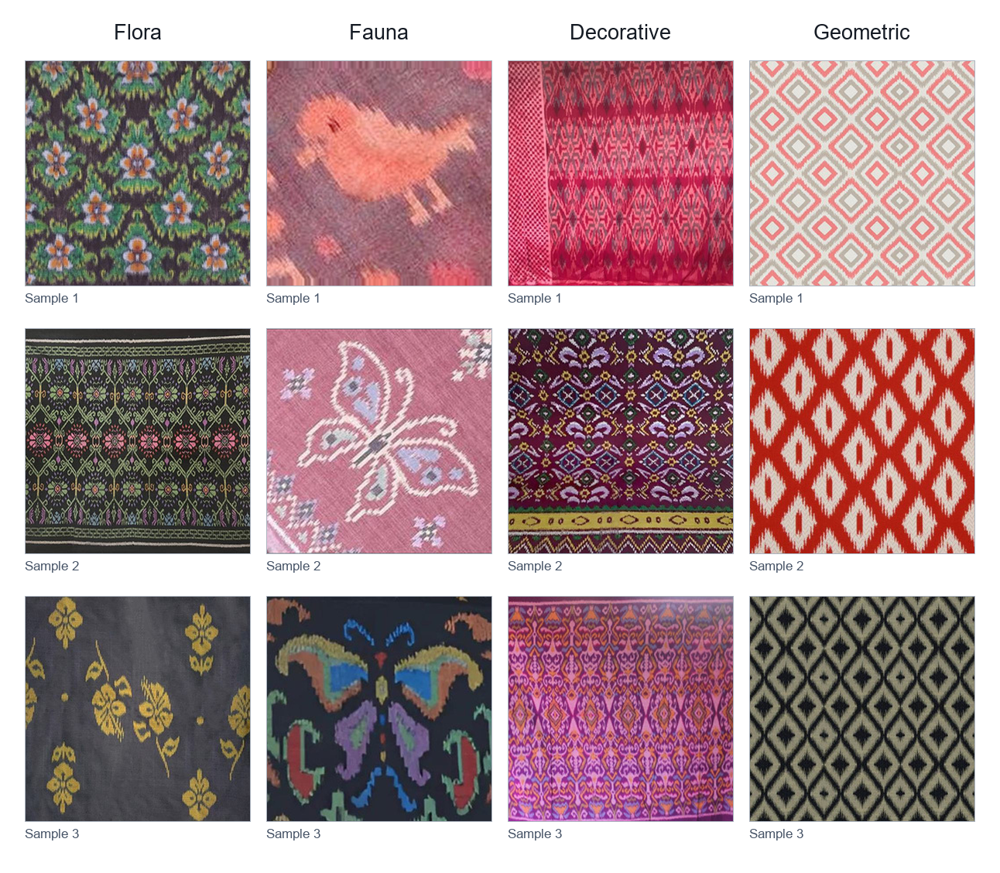
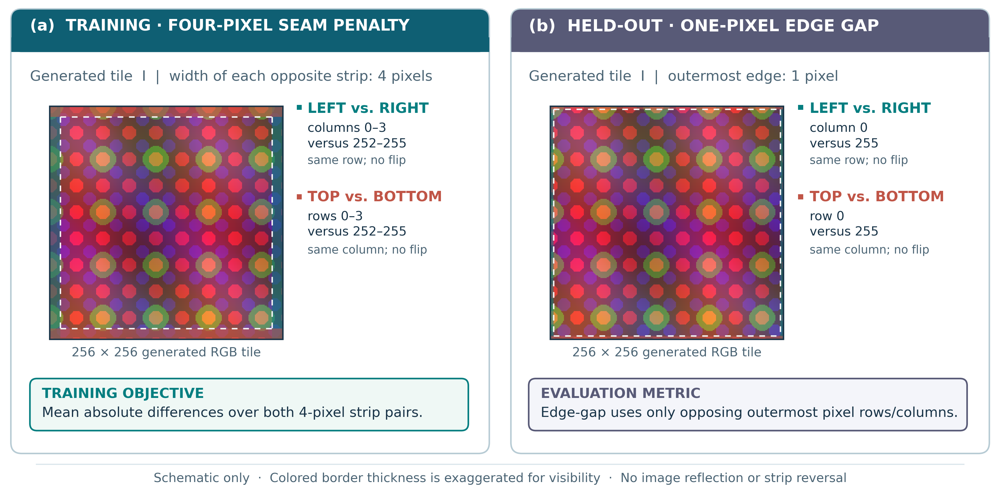
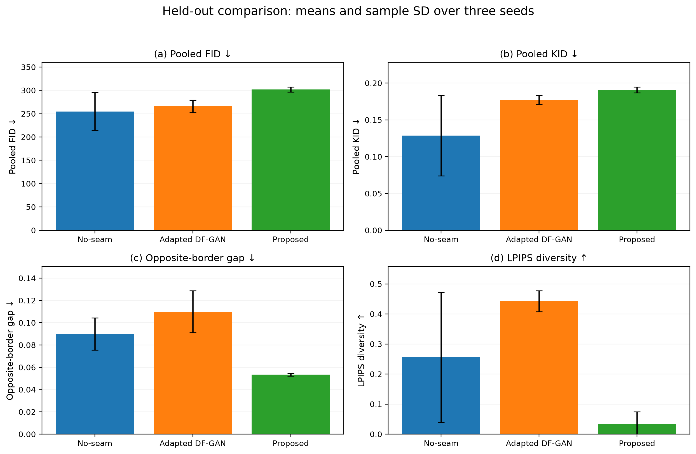
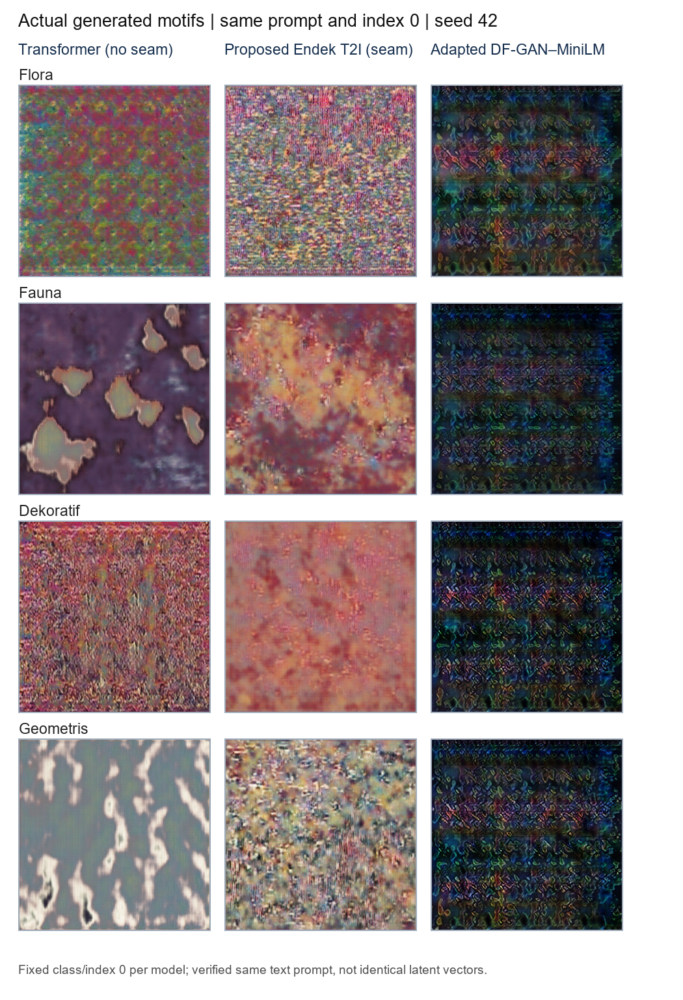
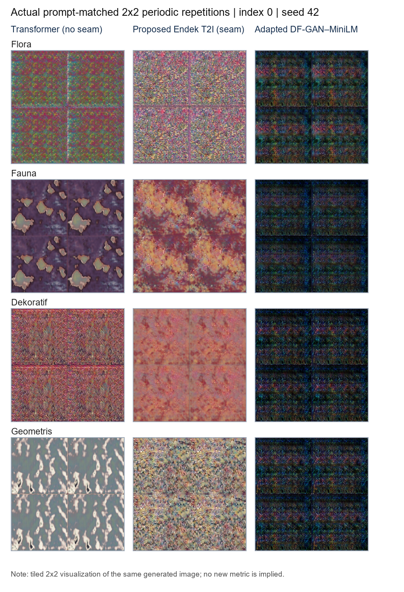
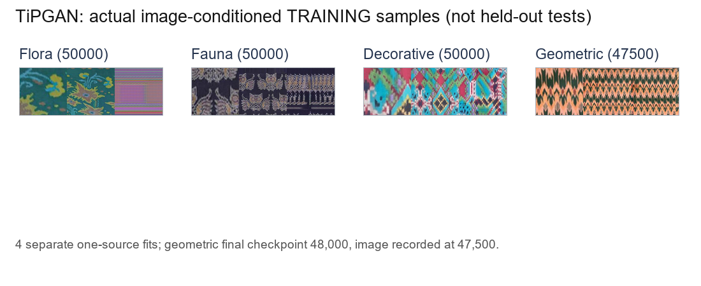

# Endek T2I: Preprocessing and Seam-Regularized Balinese Motif Synthesis

**IEEE Access submission manuscript title (20 November 2026):** **Source-Aware Preprocessing and Seam-Regularized Text-to-Image Synthesis of Balinese Endek Motifs**

**Research evidence snapshot: 20 November 2026 (historical 17 November snapshot retained).** Internal training, three-seed held-out Arm A/B evaluations, and adapted DF-GAN three-seed held-out tests are verified. Four TiPGAN train-only fits are complete, but independent TiPGAN tests and cultural/semantic validation remain incomplete. This repository contains source-backed research summaries, program code, notebooks, diagrams, tables and figures, **not** the full private Endek photograph collection or checkpoints. The selected Figure 1 montage contains actual training-source examples; authors must verify public redistribution permissions.

> **Separate studies:** This is the **preprocessing-controlled V2 study**, maintained separately from the [earlier EndekGAN-T2I repository](https://github.com/wiwik-instiki/EndekGAN-T2I). The earlier study is not overwritten or re-labelled as V2. Multilingual text conditioning and seam regularization existed in that study; they are **not claimed as newly invented** here.

**Publication nomenclature:** The method in this article is **Endek T2I** (exact name; **no V2 suffix**). Names containing V2 in legacy experiment directories, kernel IDs, charts, or archive filenames are internal traceability labels and are **not** the scientific method name. Earlier [EndekGAN-T2I](https://github.com/wiwik-instiki/EndekGAN-T2I) remains a separate prior work. The article uses verifiable cultural-preservation motivation without claiming that all Endek weaving has already disappeared. See [cultural positioning and naming policy](docs/CULTURAL_PRESERVATION_AND_ENDEK_T2I_NAMING.md).

**Navigation:** [Latest verified evidence](#0-manuscript-aligned-evidence-release-20-november-2026) · [All final figures](figures/paper_IEEE_Access_720dpi_20261120/README.md) · [Code and data availability](#code-and-data-availability-ieee-access) · [Research framework](#1-research-framework-and-comparison-logic) · [Dataset](#2-dataset-and-source-aware-preprocessing) · [Figures 1–5](#3-ieee-access-manuscript-figures-figs-15) · [Results and IEEE figures 6–13](#4-ieee-access-results-and-comparative-evaluation) · [Publication gate](#5-dataset-adequacy-and-scientific-gate) · [Reproducibility](#7-reproducibility-and-file-organization) · [Manuscript references](#8-manuscript-and-bibliography-resources)

## 0. Manuscript-aligned evidence release (20 November 2026)

**Paper:** *Source-Aware Preprocessing and Seam-Regularized Text-to-Image Synthesis of Balinese Endek Motifs.* The article describes **Endek T2I**; suffixes such as V2 in internal filenames are experiment identifiers, not a new method name. The earlier EndekGAN-T2I study is a separate predecessor, not the dataset or experiment evidence source for this article.

The article reports **three contributions (C1–C3) answering two research questions (RQ1–RQ2)**.

| Contribution | Corresponding RQ | Evidence confirmed by the completed manuscript |
|---|---|---|
| **C1 — Source-aware preprocessing ablation** | RQ1 | Fixed 296 original training sources; Arm A 944 full-frame/augmented training views versus Arm B 1,280 views including 336 train-only crops. Checkpoint-validation KID fell from 0.23041 to 0.12669 (no seam) and from 0.24581 to 0.18445 (seam). **Independent held-out evaluation** shows lower pooled FID and KID for Arm B in **6/6 model–seed comparisons** and lower class-wise FID and KID in **22/24 class–seed comparisons** for each metric. |
| **C2 — Matched fidelity–boundary–diversity evaluation** | RQ2 | In the controlled no-seam/proposed comparison, proposed one-pixel border gap improved from **0.08993 to 0.05338** (−40.65%), while pooled FID worsened from **254.474 to 302.127**, KID from **0.12848 to 0.19085**, and LPIPS diversity decreased from **0.25630 to 0.03315**. These values reveal a trade-off, **not universal generative superiority**. |
| **C3 — Traceable empirical protocol and failure diagnostics** | RQ1/RQ2 | Six Arm A validation-selected checkpoints and **1,536 generated images** were synchronized; **1,617/1,617 output files matched their Kaggle SHA-256 manifest**, with zero missing/corrupt files. Analysis includes source-group independence checks, qualitative failures, per-class performance, tiling and near-collapse LPIPS warnings. |

**Dataset and sampling:** 370 original source photographs divided **296 train / 37 validation / 37 held-out test**. Source SHA-256 intersection between partitions is zero; the 944 and 1,280 views are derived observations, not independent acquired images. Test references are unequal by class (**flora 15, fauna 5, decorative 11, geometric 6**) while each synthetic run uses 64 generated samples per class (256 total). Pooled and class-wise FID/KID are *exploratory* under the small real reference set and class-mixture mismatch.

**Controls and limitations:** the paired internal seam/no-seam variants control architecture and configured settings, but Arm A/B and external adapted DF-GAN differ in actual training budgets and/or architectures; do **not** label them fully compute matched. Near-duplicate visual screening flagged one train–validation candidate, manually judged distinct, but independent physical-acquisition records were unavailable. Very low proposed-model LPIPS (especially seed 123) warns of attenuated diversity; this is not mechanistic proof of mode collapse. Figure 11 documents four TiPGAN training-only image-conditioned fits, **not comparable held-out text-to-image results**. Expert cultural authenticity, prompt adherence and weaveability remain unverified.

### Final figures and public evidence

All **13 manuscript figures** are indexed in the [720-dpi figure package](figures/paper_IEEE_Access_720dpi_20261120/README.md), including the [image/checksum manifest](figures/paper_IEEE_Access_720dpi_20261120/FIGURE_MANIFEST.csv). Figure 1 contains already-public source-derived examples; redistribution permission must still be confirmed by the image-rights holder. Figures 12–13 are newly rendered from the verified class-wise numeric data at native 720 dpi, and may differ cosmetically from the DOCX raster artwork. For panels upscaled from earlier raster sources, 720 dpi is output raster density, **not restored optical detail**.

- [Validated Arm A/B held-out pooled FID/KID (all six model–seed pairs)](results/Arm_A_vs_B_heldout_pooled_20261120.csv)
- [Validated Arm A/B held-out class-wise FID/KID (30 rows, including pooled)](results/Arm_A_vs_B_heldout_classwise_20261120.csv)
- [Sanitized Kaggle output integrity audit](results/ARM_A_KAGGLE_AUDIT_PUBLIC_20261120.json)
- [Contribution–RQ–evidence manuscript alignment](docs/MANUSCRIPT_ALIGNMENT_C1_C2_C3_20261120.md)
- [Figures 1–13 folder](figures/paper_IEEE_Access_720dpi_20261120/README.md)

Full private source images, prompt-linked metadata, all checkpoints and source-level provenance remain excluded from the public release. Research figures and aggregate results support auditability, not unaided full training replication. **Do not use the earlier EndekGAN-T2I repository as the evidence source for this study.**

### Post hoc boundary-width and fixed-latent checks (Supplementary RQ2 evidence)

These checks were run *after* review of the primary results, without retraining or selecting new checkpoints on the test set. They are **exploratory** and were not the prespecified RQ outcomes.

| RGB opposing-border width | No-seam gap ↓ | Proposed gap ↓ | Proposed lower across 12 class–seed cells |
|---|---:|---:|---:|
| 1 px | 0.08993 | 0.05338 | 12/12 |
| 4 px | 0.10825 | 0.05643 | 12/12 |
| 8 px | 0.10582 | 0.08940 | 9/12 |

All 1,536 held-out Arm B generated images were checked. The 1-pixel recomputation agreed with previously recorded values. The extended metric is the mean aligned left/right and top/bottom strip RGB-L1 discrepancy, not a complete perception-based tileability measure.

A second inference-only intervention used the two existing model variants, all three seeds and four categories, three single-attribute changes (color, layout, technique), and four matched latent vectors: **288 fixed-latent prompt pairs**. Mean no-seam versus proposed image RMSE was **0.01222 / 0.00443** (color), **0.00488 / 0.00159** (layout), and **0.01383 / 0.00510** (technique). A crude unvalidated color-direction rule passed **12/48** no-seam versus **27/48** proposed pairs. These figures show responsiveness to text changes, not verified semantics, accurate ornament identity, or cultural acceptance.

The quantitative summaries are available in [band-width pooled results](results/BAND_GAP_POOLED_1_4_8_20261120.csv), [paired class–seed strip-width results](results/BAND_GAP_PAIRED_12CELLS_20261120.csv), and [counterfactual summary](results/PROMPT_FIXED_LATENT_SUMMARY_20261120.csv). No source-linked prompt texts, complete private dataset, or training checkpoints have been added to the public release.

## Code and data availability (IEEE Access)

See the [manuscript-aligned availability statement and evidence map](docs/CODE_AND_DATA_AVAILABILITY_IEEE.md). This public release contains research scripts, sanitized notebooks, aggregate source counts, three-seed numerical results and selected images. The **complete private Endek source dataset, derived training views, source-linked prompt metadata, full logs and trained checkpoints are not released**, so full training cannot be reproduced from public files alone. The source-image montage already visible in Figure 1 requires public redistribution-rights verification.

## 1. Research framework and comparison logic

| Scientific role | Reference / implementation | Legitimate scope of comparison |
|---|---|---|
| **Primary textile reference** | [TiPGAN, He et al., Computer-Aided Design (2025)](https://doi.org/10.1016/j.cad.2025.103866) | Image-reference-conditioned textile texture/tileability; **does not take a text prompt**. The November 17 evidence snapshot documented a 30-iteration pilot; four later image-conditioned train-only runs completed, but no matched held-out TiPGAN quality evaluation is available. |
| **Secondary external comparator** | [DF-GAN, Tao et al., IEEE/CVF CVPR (2022)](https://doi.org/10.1109/CVPR52688.2022.01602) | Same task family, text-to-image. A **MiniLM384-adapted** official NetG/NetD/NetC reproduction was retrained on V2, distinct from canonical DAMSM conditioning. |
| **Proposed Endek T2I** | Text + motif class → conditional GAN → seam regularization | Balinese Endek prompts, 256 × 256 images, source-grouped preprocessing, internal no-seam ablation and A/B augmentation comparison. |
| **Internal ablation** | Transformer / no-seam EndekGAN | Same architecture and prompts, seam regularization disabled, three matched seeds; **not a third literature comparator**. |

**Research question:** What quality, diversity, and periodic-border-continuity trade-offs emerge when using structured text and class conditions for Endek motif synthesis with source-grouped preprocessing? Unlike a fabricated superiority narrative, the genuine three-seed evidence reveals improved edge continuity alongside lower FID/KID performance and diversity.

[Main-reference gap and novelty audit](docs/REFERENCE_NOVELTY_BASELINE_PROTOCOL.md) · [IEEE Access originality gate](docs/NOVELTY_AND_EXPERIMENT_READINESS_GATE_20261117.md) · [Two main references (BibTeX)](docs/PRIMARY_AND_SECONDARY_REFERENCES.bib)

## 2. Dataset and source-aware preprocessing

The **primary experimental Arm B** contains **1,280 training records, 37 validation images and 37 held-out test images**, resized to **256 × 256 RGB**.

| Motif class | Training, Arm B | Validation | Held-out test | Independent training sources |
|---|---:|---:|---:|---:|
| Flora | 320 | 14 | 15 | 118 |
| Fauna | 320 | 6 | 5 | 42 |
| Decorative | 320 | 11 | 11 | 90 |
| Geometric | 320 | 6 | 6 | 46 |
| **Total** | **1,280** | **37** | **37** | **296** |

**296 train + 37 validation + 37 test = 370 independent source images.** The 1,280 Arm B training records are **944 full-frame/augmented records + 336 crop-derived training views**, not 1,280 newly acquired photographs. Arm A, the ablation, has **944 train records derived from the same 296 train sources**. There is no exact source-SHA256 overlap across splits. Semantics of inherited crop prompts and all expert-validation flags remain **unverified**; no external imagery was integrated.

### Supplementary preprocessing charts

The primary manuscript workflow is **Fig. 2** above. For additional quantitative context, see [class balance and independent sources](figures/fig17_preprocessed_class_balance.png) and [augmentation/crop training exposure](figures/fig18_training_exposure_after_preprocessing.png). These supplementary plots are not numbered as manuscript figures.

**Tables:** [Class and partition counts](tables/TABLE_01_PREPROCESSED_CLASS_DISTRIBUTION.csv), [stage counts](tables/TABLE_02_PREPROCESSING_STAGE_COUNTS.csv). [Dataset methods](docs/DATASET_PREPROCESSED_IEEE_20261117.md). [Complete figure/table explanations](docs/VISUAL_REPORT_PREPROCESSING_AND_EVALUATION.md).

**Section III Methods evidence audit (20 November 2026):** [Near-duplicate screening, baseline fairness and exact metric definitions](docs/METHODS_AUDIT_NEAR_DUPLICATE_FAIRNESS_METRICS_20261120.md). The one flagged train–validation pair appears to be different images following visual review, but independent physical acquisition remains unverified. External DF-GAN is task/data matched, not architecture/optimizer/compute matched. Pooled FID/KID also reflect unequal class distributions (37 unbalanced real references vs. 256 balanced generated outputs), so the results remain exploratory.

<!-- BEGIN IEEE ACCESS METHODOLOGY FIGURES 1-5 -->
## 3. IEEE Access manuscript figures (Figs. 1–5)

The five methodological figures below correspond to the revised **Endek T2I** manuscript. Figure 1 uses actual preprocessed Arm B training-source examples, **not generated motifs**. Figures 2–5 explain experimental procedures and model structure; they are schematic, not results. These panels do **not** establish expert-certified cultural authenticity or completed TiPGAN benchmarks.

> **Provenance and publication note.** The Figure 1 montage contains twelve selected source-derived training images, not the complete dataset. Public redistribution rights for the illustrated textile photographs must be confirmed by the authors. No private manifests, prompt text, full datasets, model checkpoints, or credentials are included.

### Figure 1

*Fig. 1. Representative preprocessed Arm B training images across flora, fauna, decorative and geometric motif categories (three samples each). No GAN-generated images.*

### Figure 2

*Fig. 2. Source-aware data partitioning and preprocessing for Arm A (full-frame control) and Arm B (crop-enriched treatment).*

### Figure 3

*Fig. 3. Source-aware experimental framework of Endek T2I, RQ1/RQ2 ablations, DF-GAN–MiniLM text-conditioned comparison and TiPGAN image-conditioned reference.*

### Figure 4

*Fig. 4. Implemented Endek T2I conditional GAN with multilingual text and class conditioning, separate generator/discriminator projection paths, distinct losses and optimization.*

### Figure 5

*Fig. 5. Schematic comparison of four-pixel opposing-border seam penalty during training and one-pixel opposing-edge gap measured at held-out evaluation.*

The method employs 296 independent training sources plus 37 validation and 37 held-out test sources. Arm A has 944 training views; Arm B adds 336 training-only crops to yield 1,280 views. The generator and discriminator use separate 256-dimensional condition projectors. RQ1 compares crop exposure; RQ2 contrasts seam regularization against a no-seam control. The seam objective uses four-pixel strips, whereas held-out edge-gap uses the outermost pixel only. TiPGAN accepts a reference image, not a language prompt.

The diagrams describe the **Methods** protocol, not a completed claim of benchmark superiority. In particular, the earlier documented 30-iteration TiPGAN pilot is distinct from later Kaggle training attempts; full TiPGAN results require separate verified evaluation. See the [file manifest](figures/manuscript_methods_2026/MANIFEST.json) for figure dimensions and SHA-256 checksums.

<!-- END IEEE ACCESS METHODOLOGY FIGURES 1-5 -->

## 4. IEEE Access results and comparative evaluation (Figs. 6–13)

**Exact manuscript cross-reference (20 November 2026).** This section follows the numbering of Section IV in the IEEE Access Word manuscript: **Tables V–XI and Figures 6–13**. Figures 1–5 belong to the Methods section. All new qualitative panels are copied byte-for-byte from the actual figures inserted in the manuscript; older panels retained elsewhere in the repository are supplementary visualizations.

### 4.1 Experimental coverage and evidence (Table V)

Two research questions structure the comparison: RQ1 addresses source-aware crop augmentation under fixed original-image partitions; RQ2 quantifies border-consistency versus fidelity and diversity. The independent dataset is **296 training + 37 validation + 37 held-out test original source photographs**. Arm B contains 1,280 training views derived from 296 training sources; Arm A has 944 views from the same originals.

**Table V. Experimental arms and availability of independent evaluation.**

| Experimental arm | Training exposure | Executed trainings | Held-out evaluation |
|---|---|---|---|
| Arm A (full-frame controls) | 944 train-derived views from 296 original training sources | 2 settings × 3 seeds = 6 | **6 held-out FID/KID and diversity diagnostics completed and SHA-256 validated** |
| Arm B (crop enriched) | 1,280 derived train views, same 296 sources | 6 settings × 3 seeds = 18 | 6 matched held-out tests for no-seam/proposed |
| Adapted DF-GAN–MiniLM | Source-grouped Endek set | 3 training seeds | 3 held-out tests, 37 real and 256 synthetic each |
| TiPGAN image-conditioned | Separate single-train-reference image per category | 4 category-specific runs | **No matched held-out test** |

The 24 Endek internal trainings do not mean 24 fully evaluated held-out tests. The four TiPGAN training fits cannot be inserted into text-conditioned FID/KID tables.

### 4.2 RQ1 — Preprocessing and validation (Table VI; Fig. 6)

Arm A full-frame preprocessing and Arm B crop-enriched preprocessing were evaluated with identical source-level train/validation/test partitions and three seeds. The numerical values are **checkpoint-validation KID** rather than held-out KID.

**Table VI. Three-seed checkpoint-validation KID (mean ± sample SD).**

| Configuration | Arm A validation KID ↓ | Arm B validation KID ↓ |
|---|---:|---:|
| Transformer / no-seam | 0.23041 ± 0.02673 | 0.12669 ± 0.06152 |
| Endek T2I proposed (seam) | 0.24581 ± 0.01443 | 0.18445 ± 0.01369 |

*Fig. 6. Checkpoint-validation KID after source-aware preprocessing for the Arm A full-frame control and Arm B crop-enriched treatment; not an independent held-out test result.*

### 4.3 RQ2 — Held-out comparison (Table VII; Fig. 7)

For each of three training seeds (42, 123, 2025), the same 37 independent held-out real sources and 256 generated samples per model–seed were used to evaluate the proposed Endek T2I, its no-seam control and adapted DF-GAN–MiniLM. Results are **three-seed means ± sample SD**, not significance tests.

**Table VII. Matched held-out synthesis fidelity, opposing-border continuity, and perceptual diversity (mean ± sample SD).**

| Model | Pooled FID ↓ | Pooled KID ↓ | Opposite-border gap ↓ | LPIPS diversity ↑ |
|---|---:|---:|---:|---:|
| Transformer / no-seam | 254.474 ± 40.967 | 0.12848 ± 0.05458 | 0.08993 ± 0.01449 | 0.25630 ± 0.21681 |
| Adapted DF-GAN–MiniLM | 265.696 ± 13.561 | 0.17703 ± 0.00625 | 0.10984 ± 0.01888 | 0.44268 ± 0.03472 |
| **Endek T2I proposed (seam)** | 302.127 ± 5.459 | 0.19085 ± 0.00405 | 0.05338 ± 0.00120 | 0.03315 ± 0.04134 |

The proposed model reduces mean opposing-border gap by **40.65%** relative to its no-seam control and **51.40%** relative to adapted DF-GAN–MiniLM, but it has worse pooled FID, KID and inter-sample LPIPS diversity. These outcomes document a **continuity–fidelity–diversity trade-off**, not universal superiority.

*Fig. 7. Exploratory three-seed held-out comparison of pooled FID, KID, opposite-border gap and LPIPS diversity for the proposed model and both comparators, with sample-SD bars.*

### 4.4 Seed-wise comparisons (Table VIII; Fig. 8)

**Table VIII. All nine model–seed held-out results.**

| Model | Seed | FID ↓ | KID ↓ | Border gap ↓ | LPIPS diversity ↑ |
|---|---:|---:|---:|---:|
| Transformer / no-seam | 42 | 247.819 | 0.11162 | 0.07951 | 0.37734 |
| Transformer / no-seam | 123 | 217.242 | 0.08432 | 0.08381 | 0.38556 |
| Transformer / no-seam | 2025 | 298.361 | 0.18951 | 0.10648 | 0.00599 |
| Adapted DF-GAN–MiniLM | 42 | 250.430 | 0.16983 | 0.11737 | 0.45042 |
| Adapted DF-GAN–MiniLM | 123 | 276.346 | 0.18034 | 0.12379 | 0.47288 |
| Adapted DF-GAN–MiniLM | 2025 | 270.312 | 0.18092 | 0.08836 | 0.40474 |
| Endek T2I proposed (seam) | 42 | 302.471 | 0.19289 | 0.05246 | 0.07974 |
| Endek T2I proposed (seam) | 123 | 307.406 | 0.19347 | 0.05295 | 0.00084 |
| Endek T2I proposed (seam) | 2025 | 296.505 | 0.18618 | 0.05473 | 0.01888 |

*Fig. 8. Per-seed held-out FID, KID, border gap and LPIPS diversity for Transformer/no-seam, adapted DF-GAN–MiniLM, and proposed Endek T2I.*

### 4.5 Actual generated Endek samples (Figs. 9 and 10)

The next two panels are identical to the **actual model-generated outputs and two-by-two tile visualizations embedded in the Word manuscript**. Flora, Fauna, Decorative, and Geometric rows are compared at seed 42 using a fixed within-class index of 0, with verified prompt matches across model outputs. The samples illustrate qualitative texture, not blinded cultural/semantic expert certification.

*Fig. 9. Actual matched seed-42 Endek outputs from Transformer/no-seam, proposed seam-regularized Endek T2I and adapted DF-GAN–MiniLM, with the same text prompt and index in all four motif categories.*

*Fig. 10. Two-by-two periodic tiling of the same fixed-index images shown in Fig. 9, illustrating opposite-edge appearance without claiming an additional quantitative tileability experiment.*

### 4.6 TiPGAN reference: training only (Table IX; Fig. 11)

TiPGAN is **image-conditioned** and trained using a **single TRAIN-source reference image per class**. It is not a text-conditioned competitor under the matched evaluation protocol.

**Table IX. Verified TiPGAN single-reference training outcomes; no independent evaluation.**

| Motif class | Platform | Terminal iterations / maximum | Training status |
|---|---|---:|---|
| Flora | Kaggle | 50000 / 50000 | Finished |
| Fauna | local GPU | 50000 / 50000 | Finished |
| Decorative | local GPU | 50000 / 50000 | Finished |
| Geometric | Kaggle | 48000 / 50000 | Early Stopped |

*Fig. 11. Actual image-conditioned TiPGAN training samples from four single-source runs. The geometric visual sample is from iteration 47,500, with a final checkpoint at iteration 48,000; these are not held-out text-conditioned evaluations.*

### 4.7 Validity boundaries, release restrictions, and paper alignment

Only 37 independent real source images were held out (5–15 per category); pooled FID and KID remain exploratory. Crop prompts and expert cultural/weaving assessments remain unverified. Full training data, private source-to-prompt manifests and model weights are **not publicly included**. The public release includes selected actual generated figures from the manuscript, but not the original source-image dataset; selected source images already present in methodological Fig. 1 remain subject to redistribution-rights review.

**Official crosswalk:** [Figures, numerical data and SHA-256 provenance](docs/IEEE_RESULTS_README_PROVENANCE_20261120.md) · [Code and Data Availability](docs/CODE_AND_DATA_AVAILABILITY_IEEE.md) · [All 24 internal training runs](results/all_24_runs.csv) · [All nine held-out model–seed evaluations](results/DFGAN_EndekGAN_real_matched_three_seeds.csv) · [TiPGAN statuses](results/TIPGAN_FOUR_CLASS_TRAINING_STATUS_20261120.csv).

**Scientific scope:** results are presented for transparent reporting, not as proof of universal model superiority or certified textile production suitability.
### 4.6 Final class-wise and diversity diagnostics (Figures 12–13)

[Figure 12 — class-wise fidelity / boundary trade-off](figures/paper_IEEE_Access_720dpi_20261120/Fig_12_Endek_T2I_720dpi.png) and [Figure 13 — per-class LPIPS diversity across seeds](figures/paper_IEEE_Access_720dpi_20261120/Fig_13_Endek_T2I_720dpi.png) correspond to the final Section IV-G and IV-I of the paper. The proposed seam model consistently lowers one-pixel opposite-border mismatch in all twelve matched class–seed comparisons but loses fidelity and perceptual diversity. Figure 13's near-zero proposed LPIPS for seed 123 is a diagnostic warning, not conclusive proof of mode collapse.

These regenerated 720-dpi panels are source-backed by [the underlying three-seed per-class observations](results/heldout_B_transformer_vs_seam_all3seeds_allclasses.csv). Refer to the figure package for the complete numbering and originality note.

## 5. Dataset adequacy and scientific gate

**Do not submit as dataset sufficiency demonstrated.** The 1,280 Arm B training files correspond to **296 unique independent source images** (370 independent images across train/validation/test). Training augmentation and crops cannot replace additional independent observations. The held-out test has only 37 real images, with just 5–15 per class. The first manuscript was rejected, and the research team identified small dataset size as a central weakness. A new title or enhanced augmentation alone cannot establish independent-data generalization.

Before final manuscript submission, obtain a materially larger, copyright-cleared collection of authentic Endek motifs across the four verified classes; audit duplicate and near-duplicate groups **before** splitting; rerun the preprocessing protocol, train all compared models with matched budgets and at least 3 seeds, and evaluate on independent, diverse test sources with uncertainty analysis. Maintain a locked external or provenance-distinct test domain where feasible. Record provenance and permissions and independently assess text-prompt semantic fidelity and cultural authenticity. Do not assert an arbitrary IEEE-required minimum image count: adequacy must be supported by performance saturation, diversity coverage, and confidence intervals.

Current figures and tables are **V2 exploratory evidence only**, not final expanded-dataset results. Track actions in [Dataset adequacy and novelty readiness](docs/IEEE_ACCESS_DATASET_AND_NOVELTY_GATE.md).

## 6. Research integrity and manuscript status

1. **The earlier EndekGAN-T2I architecture already included multilingual text conditioning and seam loss.** This study must not claim to invent these components. Additional architectural novelty requires real code and ablation evidence.
2. Validation KID and held-out FID/KID are fundamentally different; figures/tables keep them separate. FID/KID with 37 independent real reference images are exploratory.
3. No manual text-prompt/crop-semantic approval or blinded cultural-authenticity panel has been completed. No actual weaving reproducibility is verified.
4. The public repository intentionally omits the complete original Endek photograph dataset, confidential prompts, private source manifests with machine-local paths, heavyweight checkpoints and credentials; the limited source-derived manuscript Figure 1 montage already visible here is subject to public redistribution-rights review. They remain on the authorized laptop/Kaggle private storage.
5. **Target journal:** IEEE Access. The material is research evidence and a manuscript preparation base, **not yet submission-ready**. The provisional title may change to reflect verified results.

[Source bibliography](docs/PRIMARY_AND_SECONDARY_REFERENCES.bib) · [Reference-to-novelty framework](docs/REFERENCE_NOVELTY_BASELINE_PROTOCOL.md) · [IEEE Access evidence audit](results/EVIDENCE_STATUS_IEEE_ACCESS_20261117.json).

### Project relationship

**Current V2 repository (this project):** https://github.com/wiwik-instiki/EndekGAN-T2I-with-Preprocessing

**Earlier independent baseline study (not modified):** https://github.com/wiwik-instiki/EndekGAN-T2I

## 7. Reproducibility and file organization

| Repository directory | Content |
|---|---|
| [data/](data/) | Aggregate-only preprocessing counts; **no original/private images or captions** |
| [docs/](docs/) | Main-reference reasoning, preprocessing audit, draft methodological notes, figure and metric captions |
| [tables/](tables/) | Preprocessing partitions, A/B treatment summary, external test status, matched test metrics |
| [figures/](figures/) | Actual training loss and evaluation plots, preprocessing workflow, generated-image visual comparisons |
| [results/](results/) | Actual evaluation metrics, 24-job training and three-seed test logs/aggregates; incomplete tests explicitly marked |
| [notebooks/](notebooks/) | Sanitized/preflighted preprocessing, training and baseline-comparison notebooks |
| [scripts/](scripts/) | Reproducible scripts for reading private local sources and building **public-safe aggregates** |
| [benchmarks/](benchmarks/) | Research comparator protocols, execution records and status of external validations |

To regenerate supplementary preprocessing/evaluation graphics and Tables 1–4, run the file **scripts/build_ieee_access_visual_evidence.py** inside the authorized V2 experimental workspace; it reads the local preprocessed split manifests and results without executing GPU training. It does **not** package the raw dataset. See [visual report and figure legends](docs/VISUAL_REPORT_PREPROCESSING_AND_EVALUATION.md).

## 8. Manuscript and bibliography resources

### Introduction and citation resources

The current IEEE Access Introduction is available in [five-paragraph APA 7 working draft](manuscript/INTRODUCTION_APA7_ENDEK_T2I.md), with [import-ready BibTeX](bibliography/introduction.bib), [master bibliography](bibliography/references_master.bib), [citation and novelty audit](manuscript/INTRODUCTION_CITATION_AUDIT.md), and the [Penakluk Top Tier research ledger](research_ledger/penakluk_top_tier_endek_t2i.json). These materials refer to the method as **Endek T2I** and preserve original empirical findings, including the observed seam improvement and fidelity deterioration. Convert APA author–date citations to IEEE numeric style in the final journal manuscript; the introduction does not certify that missing external experiments are complete.

### Related Work and reference audit

[Related Work manuscript](manuscript/RELATED_WORK_APA7_ENDEK_T2I.md) | [Related Work BibTeX](bibliography/related_work.bib) | [APA 7 reference list](bibliography/RELATED_WORK_REFERENCES_APA7.md) | [Reference and method audit](manuscript/RELATED_WORK_CITATION_AUDIT.md).

Four scientific subsections analyze Endek/Batik text-to-image work, tileable texture synthesis, conditional GAN and source-independent evaluation, and a literature-method comparison table. The main textile reference is TiPGAN (He et al., 2025); DF-GAN (Tao et al., 2022) remains the sole additional external text-to-image comparator. Related literature papers are not automatically additional trained baselines. Preliminary APA author-year citations will be converted to the journal's IEEE numerical style for final submission.
