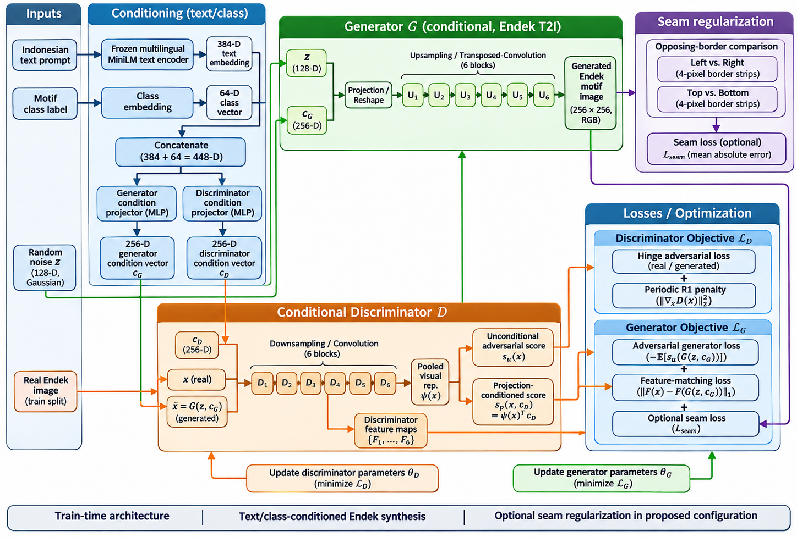

# Endek T2I: Preprocessing and Seam-Regularized Balinese Motif Synthesis

**Provisional IEEE Access title:** **Source-Aware Preprocessing and Seam-Regularized Text-to-Image Synthesis of Balinese Endek Motifs**

**Research evidence snapshot: 17 November 2026.** Training and internal three-seed tests are complete; external comparisons and cultural/semantic validation remain incomplete. This repository contains source-backed research summaries, program code, notebooks, diagrams, tables and figures, **not** the full private Endek photograph collection or checkpoints. The selected Figure 1 montage contains actual training-source examples; authors must verify public redistribution permissions.

> **Separate studies:** This is the **preprocessing-controlled V2 study**, maintained separately from the [earlier EndekGAN-T2I repository](https://github.com/wiwik-instiki/EndekGAN-T2I). The earlier study is not overwritten or re-labelled as V2. Multilingual text conditioning and seam regularization existed in that study; they are **not claimed as newly invented** here.

**Publication nomenclature:** The method in this article is **Endek T2I** (exact name; **no V2 suffix**). Names containing V2 in legacy experiment directories, kernel IDs, charts, or archive filenames are internal traceability labels and are **not** the scientific method name. Earlier [EndekGAN-T2I](https://github.com/wiwik-instiki/EndekGAN-T2I) remains a separate prior work. The article uses verifiable cultural-preservation motivation without claiming that all Endek weaving has already disappeared. See [cultural positioning and naming policy](docs/CULTURAL_PRESERVATION_AND_ENDEK_T2I_NAMING.md).

**Navigation:** [Research framework](#1-research-framework-and-comparison-logic) · [Dataset](#2-dataset-and-source-aware-preprocessing) · [Figures 1–5](#3-ieee-access-manuscript-figures-figs-15) · [Results](#4-actual-experiments-and-evaluations) · [Publication gate](#5-dataset-adequacy-and-scientific-gate) · [Reproducibility](#7-reproducibility-and-file-organization) · [Manuscript references](#8-manuscript-and-bibliography-resources)

## 1. Research framework and comparison logic

| Scientific role | Reference / implementation | Legitimate scope of comparison |
|---|---|---|
| **Primary textile reference** | [TiPGAN, He et al., Computer-Aided Design (2025)](https://doi.org/10.1016/j.cad.2025.103866) | Image-reference-conditioned textile texture/tileability; **does not take a text prompt**. The November 17 evidence snapshot documents a 30-iteration pilot; later private Kaggle training is distinct, with no fully verified benchmark reported here. |
| **Secondary external comparator** | [DF-GAN, Tao et al., IEEE/CVF CVPR (2022)](https://doi.org/10.1109/CVPR52688.2022.01602) | Same task family, text-to-image. A **MiniLM384-adapted** official NetG/NetD/NetC reproduction was retrained on V2, distinct from canonical DAMSM conditioning. |
| **Proposed Endek T2I** | Text + motif class → conditional GAN → seam regularization | Balinese Endek prompts, 256 × 256 images, source-grouped preprocessing, internal no-seam ablation and A/B augmentation comparison. |
| **Internal ablation** | Transformer / no-seam EndekGAN | Same architecture and prompts, seam regularization disabled, three matched seeds; **not a third literature comparator**. |

**Research question:** What quality, diversity, and periodic-border-continuity trade-offs emerge when using structured text and class conditions for Endek motif synthesis with source-grouped preprocessing? Unlike a fabricated superiority narrative, the genuine three-seed evidence reveals improved edge continuity alongside lower FID/KID performance and diversity.

[Main-reference gap and novelty audit](docs/REFERENCE_NOVELTY_BASELINE_PROTOCOL.md) · [IEEE Access originality gate](docs/NOVELTY_AND_EXPERIMENT_READINESS_GATE_20261117.md) · [Two main references (BibTeX)](docs/PRIMARY_AND_SECONDARY_REFERENCES.bib)

## 2. Dataset and source-aware preprocessing

The **primary experimental Arm B** contains **1,280 training records, 37 validation images and 37 held-out test images**, resized to **256 × 256 RGB**.

| Motif class | Training, Arm B | Validation | Held-out test | Independent training sources |
|---|---:|---:|---:|---:|
| Flora | 320 | 14 | 15 | 118 |
| Fauna | 320 | 6 | 5 | 42 |
| Decorative | 320 | 11 | 11 | 90 |
| Geometric | 320 | 6 | 6 | 46 |
| **Total** | **1,280** | **37** | **37** | **296** |

**296 train + 37 validation + 37 test = 370 independent source images.** The 1,280 Arm B training records are **944 full-frame/augmented records + 336 crop-derived training views**, not 1,280 newly acquired photographs. Arm A, the ablation, has **944 train records derived from the same 296 train sources**. There is no exact source-SHA256 overlap across splits. Semantics of inherited crop prompts and all expert-validation flags remain **unverified**; no external imagery was integrated.

### Supplementary preprocessing charts

The primary manuscript workflow is **Fig. 2** above. For additional quantitative context, see [class balance and independent sources](figures/fig17_preprocessed_class_balance.png) and [augmentation/crop training exposure](figures/fig18_training_exposure_after_preprocessing.png). These supplementary plots are not numbered as manuscript figures.

**Tables:** [Class and partition counts](tables/TABLE_01_PREPROCESSED_CLASS_DISTRIBUTION.csv), [stage counts](tables/TABLE_02_PREPROCESSING_STAGE_COUNTS.csv). [Dataset methods](docs/DATASET_PREPROCESSED_IEEE_20261117.md). [Complete figure/table explanations](docs/VISUAL_REPORT_PREPROCESSING_AND_EVALUATION.md).

<!-- BEGIN IEEE ACCESS METHODOLOGY FIGURES 1-5 -->
## 3. IEEE Access manuscript figures (Figs. 1–5)

The five methodological figures below correspond to the revised **Endek T2I** manuscript. Figure 1 uses actual preprocessed Arm B training-source examples, **not generated motifs**. Figures 2–5 explain experimental procedures and model structure; they are schematic, not results. These panels do **not** establish expert-certified cultural authenticity or completed TiPGAN benchmarks.

> **Provenance and publication note.** The Figure 1 montage contains twelve selected source-derived training images, not the complete dataset. Public redistribution rights for the illustrated textile photographs must be confirmed by the authors. No private manifests, prompt text, full datasets, model checkpoints, or credentials are included.

### Figure 1

*Fig. 1. Representative preprocessed Arm B training images across flora, fauna, decorative and geometric motif categories (three samples each). No GAN-generated images.*

### Figure 2

*Fig. 2. Source-aware data partitioning and preprocessing for Arm A (full-frame control) and Arm B (crop-enriched treatment).*

### Figure 3

*Fig. 3. Source-aware experimental framework of Endek T2I, RQ1/RQ2 ablations, DF-GAN–MiniLM text-conditioned comparison and TiPGAN image-conditioned reference.*

### Figure 4

*Fig. 4. Implemented Endek T2I conditional GAN with multilingual text and class conditioning, separate generator/discriminator projection paths, distinct losses and optimization.*

### Figure 5

*Fig. 5. Schematic comparison of four-pixel opposing-border seam penalty during training and one-pixel opposing-edge gap measured at held-out evaluation.*

The method employs 296 independent training sources plus 37 validation and 37 held-out test sources. Arm A has 944 training views; Arm B adds 336 training-only crops to yield 1,280 views. The generator and discriminator use separate 256-dimensional condition projectors. RQ1 compares crop exposure; RQ2 contrasts seam regularization against a no-seam control. The seam objective uses four-pixel strips, whereas held-out edge-gap uses the outermost pixel only. TiPGAN accepts a reference image, not a language prompt.

The diagrams describe the **Methods** protocol, not a completed claim of benchmark superiority. In particular, the earlier documented 30-iteration TiPGAN pilot is distinct from later Kaggle training attempts; full TiPGAN results require separate verified evaluation. See the [file manifest](figures/manuscript_methods_2026/MANIFEST.json) for figure dimensions and SHA-256 checksums.

<!-- END IEEE ACCESS METHODOLOGY FIGURES 1-5 -->

## 4. Actual experiments and evaluations

### Training

**24/24 internal model–seed jobs completed**: six model settings under Arm B and two control settings under Arm A, each trained with random seeds **42, 123 and 2025**. Training logs and best/last checkpoints were previously audited on the private D drive. Validation KID selects checkpoints; it must **not** be presented as an independent test metric.

[24-run outcomes](results/all_24_runs.csv) · [Validation KID summary](results/three_seed_checkpoint_validation_summary.csv) · [Loss curves](figures/fig04_generator_loss.png) · [Discriminator history](figures/fig05_discriminator_loss.png) · [Seam loss history](figures/fig06_seam_loss.png).

### Completed internal three-seed held-out evaluation

| Arm B model | Pooled FID ↓ | Pooled KID ↓ | Opposite-border gap ↓ |
|---|---:|---:|---:|
| Transformer / no-seam | **254.474 ± 40.967** | **0.128485 ± 0.054584** | 0.089935 ± 0.014491 |
| **EndekGAN Seam Proposed** | 302.127 ± 5.459 | 0.190846 ± 0.004053 | **0.053379 ± 0.001198** |

Means ± **sample SD of three training seeds**, using the **same 37 original held-out test images** and **256 generated images per model/seed**. Seam Proposed reduces mean opposite-border gap by **40.65%**, but **increases FID/KID and reduces LPIPS diversity**. These are exploratory statistics with a very small independent test set and are **not** a claim of model superiority.

[View Held-out per-seed results](figures/fig19_heldout_fidelity_vs_edge_gap_by_seed.png)

[View Internal ablation mean ± SD](figures/fig20_internal_3seed_heldout_mean_sd.png)

[View A/B preprocessing validation KID](figures/fig21_preprocessing_A_B_validation_kid.png)

**Tables:** [Three-seed internal held-out test](tables/TABLE_03_MATCHED_HELDOUT_3SEED_MEAN_SD.csv), [DF-GAN external test status](tables/TABLE_04_DFGAN_HELDOUT_STATUS.csv), [per-seed internal data](results/heldout_B_transformer_vs_seam_3seeds_per_seed.csv).

### External comparisons — verify task equivalence

- **Adapted DF-GAN–MiniLM:** full training for seeds **42, 123 and 2025** completed. Independent held-out evaluation was verified for **42** (pooled FID 250.430, KID 0.169826) and **123** (FID 276.346, KID 0.180337). The 2025 held-out evaluation was subsequently archived and verified on 18 November 2026 (pooled FID 270.312, KID 0.180924). This does not imply that the historical November 17 evidence tables have been updated. Report three-seed statistics only after checking and synchronizing their source files.
- **TiPGAN:** official implementation completed a **30-iteration one-image training pilot** only. TiPGAN accepts **a reference texture image**, not a text description. Compare seam/texture properties on an explicitly separate image-conditioned protocol; do not assign text-compliance scores.
- Reference-image leakage prevention: TiPGAN must **not** train/condition on held-out test images while being reported as independent distributional testing.
- Caption fidelity and cultural/weaving suitability require additional independent evaluation of generated images by appropriately recruited Endek experts.

[External execution audit](benchmarks/EXTERNAL_BASELINE_EXECUTION.md) · [DF-GAN single-seed reference test](benchmarks/DFGAN_MiniLM_HELDOUT_SEED42.md) · [Experiment status snapshot](results/EVIDENCE_STATUS_IEEE_ACCESS_20261117.json).

### Qualitative evidence (generated outputs only)

[View Matched generated motif examples](figures/fig09_matched_actual_generated_samples_seed42.png)

[View Repeated tiling examples](figures/fig10_matched_2x2_tile_visualization_seed42.png)

[View Three-seed generated motif montage](figures/fig14_actual_B_generated_motifs_3seed_comparison.png)

## 5. Dataset adequacy and scientific gate

**Do not submit as dataset sufficiency demonstrated.** The 1,280 Arm B training files correspond to **296 unique independent source images** (370 independent images across train/validation/test). Training augmentation and crops cannot replace additional independent observations. The held-out test has only 37 real images, with just 5–15 per class. The first manuscript was rejected, and the research team identified small dataset size as a central weakness. A new title or enhanced augmentation alone cannot establish independent-data generalization.

Before final manuscript submission, obtain a materially larger, copyright-cleared collection of authentic Endek motifs across the four verified classes; audit duplicate and near-duplicate groups **before** splitting; rerun the preprocessing protocol, train all compared models with matched budgets and at least 3 seeds, and evaluate on independent, diverse test sources with uncertainty analysis. Maintain a locked external or provenance-distinct test domain where feasible. Record provenance and permissions and independently assess text-prompt semantic fidelity and cultural authenticity. Do not assert an arbitrary IEEE-required minimum image count: adequacy must be supported by performance saturation, diversity coverage, and confidence intervals.

Current figures and tables are **V2 exploratory evidence only**, not final expanded-dataset results. Track actions in [Dataset adequacy and novelty readiness](docs/IEEE_ACCESS_DATASET_AND_NOVELTY_GATE.md).

## 6. Research integrity and manuscript status

1. **The earlier EndekGAN-T2I architecture already included multilingual text conditioning and seam loss.** This study must not claim to invent these components. Additional architectural novelty requires real code and ablation evidence.
2. Validation KID and held-out FID/KID are fundamentally different; figures/tables keep them separate. FID/KID with 37 independent real reference images are exploratory.
3. No manual text-prompt/crop-semantic approval or blinded cultural-authenticity panel has been completed. No actual weaving reproducibility is verified.
4. The public repository intentionally omits real Endek photographs, confidential prompts, private source manifests with machine-local paths, heavyweight checkpoints and credentials. They remain on the authorized laptop/Kaggle private storage.
5. **Target journal:** IEEE Access. The material is research evidence and a manuscript preparation base, **not yet submission-ready**. The provisional title may change to reflect verified results.

[Source bibliography](docs/PRIMARY_AND_SECONDARY_REFERENCES.bib) · [Reference-to-novelty framework](docs/REFERENCE_NOVELTY_BASELINE_PROTOCOL.md) · [IEEE Access evidence audit](results/EVIDENCE_STATUS_IEEE_ACCESS_20261117.json).

### Project relationship

**Current V2 repository (this project):** https://github.com/wiwik-instiki/EndekGAN-T2I-with-Preprocessing

**Earlier independent baseline study (not modified):** https://github.com/wiwik-instiki/EndekGAN-T2I

## 7. Reproducibility and file organization

| Repository directory | Content |
|---|---|
| [data/](data/) | Aggregate-only preprocessing counts; **no original/private images or captions** |
| [docs/](docs/) | Main-reference reasoning, preprocessing audit, draft methodological notes, figure and metric captions |
| [tables/](tables/) | Preprocessing partitions, A/B treatment summary, external test status, matched test metrics |
| [figures/](figures/) | Actual training loss and evaluation plots, preprocessing workflow, generated-image visual comparisons |
| [results/](results/) | Actual evaluation metrics, 24-job training and three-seed test logs/aggregates; incomplete tests explicitly marked |
| [notebooks/](notebooks/) | Sanitized/preflighted preprocessing, training and baseline-comparison notebooks |
| [scripts/](scripts/) | Reproducible scripts for reading private local sources and building **public-safe aggregates** |
| [benchmarks/](benchmarks/) | Research comparator protocols, execution records and status of external validations |

To regenerate supplementary preprocessing/evaluation graphics and Tables 1–4, run the file **scripts/build_ieee_access_visual_evidence.py** inside the authorized V2 experimental workspace; it reads the local preprocessed split manifests and results without executing GPU training. It does **not** package the raw dataset. See [visual report and figure legends](docs/VISUAL_REPORT_PREPROCESSING_AND_EVALUATION.md).

## 8. Manuscript and bibliography resources

### Introduction and citation resources

The current IEEE Access Introduction is available in [five-paragraph APA 7 working draft](manuscript/INTRODUCTION_APA7_ENDEK_T2I.md), with [import-ready BibTeX](bibliography/introduction.bib), [master bibliography](bibliography/references_master.bib), [citation and novelty audit](manuscript/INTRODUCTION_CITATION_AUDIT.md), and the [Penakluk Top Tier research ledger](research_ledger/penakluk_top_tier_endek_t2i.json). These materials refer to the method as **Endek T2I** and preserve original empirical findings, including the observed seam improvement and fidelity deterioration. Convert APA author–date citations to IEEE numeric style in the final journal manuscript; the introduction does not certify that missing external experiments are complete.

### Related Work and reference audit

[Related Work manuscript](manuscript/RELATED_WORK_APA7_ENDEK_T2I.md) | [Related Work BibTeX](bibliography/related_work.bib) | [APA 7 reference list](bibliography/RELATED_WORK_REFERENCES_APA7.md) | [Reference and method audit](manuscript/RELATED_WORK_CITATION_AUDIT.md).

Four scientific subsections analyze Endek/Batik text-to-image work, tileable texture synthesis, conditional GAN and source-independent evaluation, and a literature-method comparison table. The main textile reference is TiPGAN (He et al., 2025); DF-GAN (Tao et al., 2022) remains the sole additional external text-to-image comparator. Related literature papers are not automatically additional trained baselines. Preliminary APA author-year citations will be converted to the journal's IEEE numerical style for final submission.
