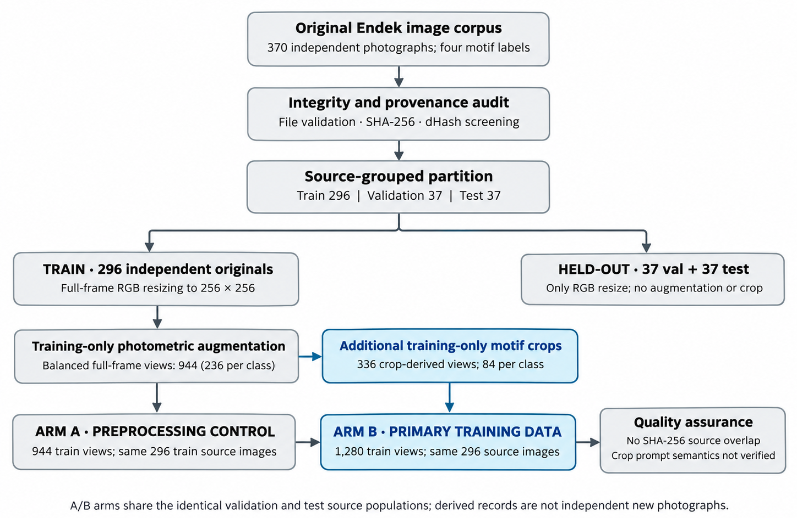
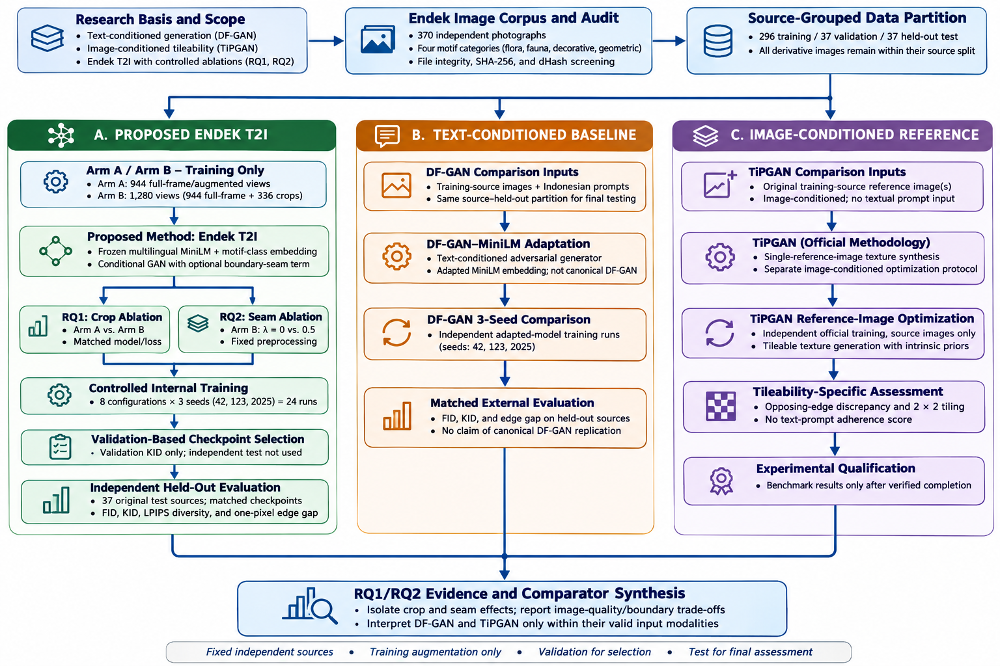
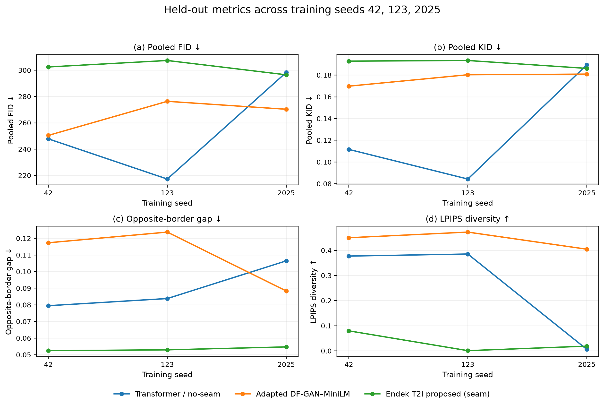
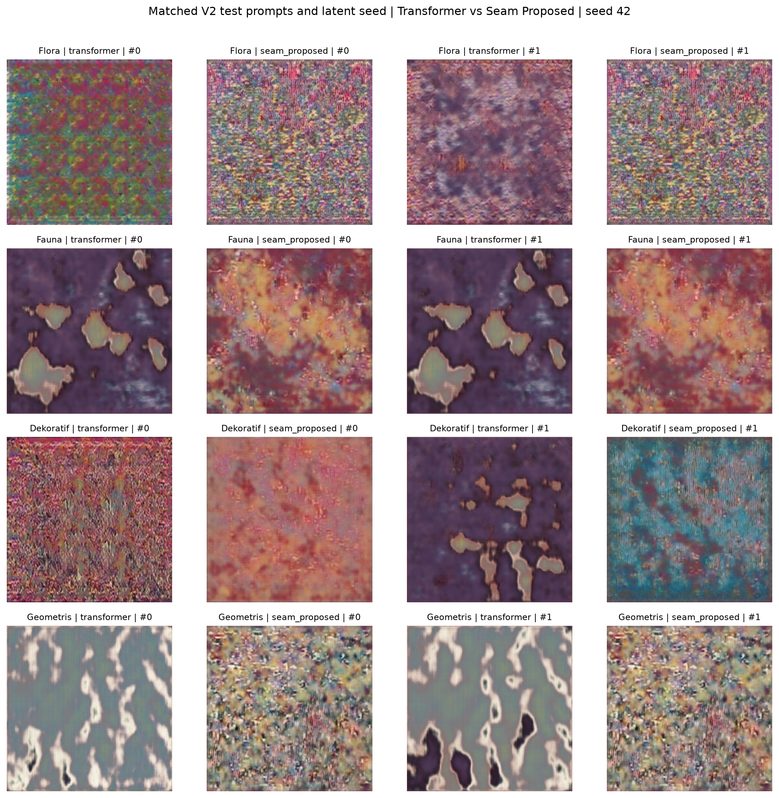
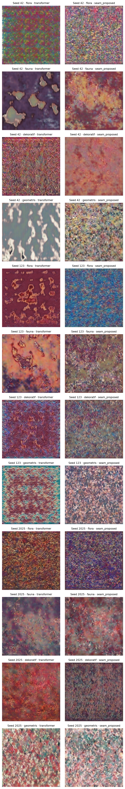

# Endek T2I: Preprocessing and Seam-Regularized Balinese Motif Synthesis

**Provisional IEEE Access title:** **Source-Aware Preprocessing and Seam-Regularized Text-to-Image Synthesis of Balinese Endek Motifs**

**Research evidence snapshot: 20 November 2026 (historical 17 November snapshot retained).** Training and internal three-seed tests are complete; adapted DF-GAN three-seed held-out tests are verified. Four TiPGAN train-only fits are complete, but independent TiPGAN tests and cultural/semantic validation remain incomplete. This repository contains source-backed research summaries, program code, notebooks, diagrams, tables and figures, **not** the full private Endek photograph collection or checkpoints. The selected Figure 1 montage contains actual training-source examples; authors must verify public redistribution permissions.

> **Separate studies:** This is the **preprocessing-controlled V2 study**, maintained separately from the [earlier EndekGAN-T2I repository](https://github.com/wiwik-instiki/EndekGAN-T2I). The earlier study is not overwritten or re-labelled as V2. Multilingual text conditioning and seam regularization existed in that study; they are **not claimed as newly invented** here.

**Publication nomenclature:** The method in this article is **Endek T2I** (exact name; **no V2 suffix**). Names containing V2 in legacy experiment directories, kernel IDs, charts, or archive filenames are internal traceability labels and are **not** the scientific method name. Earlier [EndekGAN-T2I](https://github.com/wiwik-instiki/EndekGAN-T2I) remains a separate prior work. The article uses verifiable cultural-preservation motivation without claiming that all Endek weaving has already disappeared. See [cultural positioning and naming policy](docs/CULTURAL_PRESERVATION_AND_ENDEK_T2I_NAMING.md).

**Navigation:** [Research framework](#1-research-framework-and-comparison-logic) · [Dataset](#2-dataset-and-source-aware-preprocessing) · [Figures 1–5](#3-ieee-access-manuscript-figures-figs-15) · [Results and IEEE figures 6–11](#4-ieee-access-results-and-comparative-evaluation) · [Publication gate](#5-dataset-adequacy-and-scientific-gate) · [Reproducibility](#7-reproducibility-and-file-organization) · [Manuscript references](#8-manuscript-and-bibliography-resources)

## 1. Research framework and comparison logic

| Scientific role | Reference / implementation | Legitimate scope of comparison |
|---|---|---|
| **Primary textile reference** | [TiPGAN, He et al., Computer-Aided Design (2025)](https://doi.org/10.1016/j.cad.2025.103866) | Image-reference-conditioned textile texture/tileability; **does not take a text prompt**. The November 17 evidence snapshot documents a 30-iteration pilot; later private Kaggle training is distinct, with no fully verified benchmark reported here. |
| **Secondary external comparator** | [DF-GAN, Tao et al., IEEE/CVF CVPR (2022)](https://doi.org/10.1109/CVPR52688.2022.01602) | Same task family, text-to-image. A **MiniLM384-adapted** official NetG/NetD/NetC reproduction was retrained on V2, distinct from canonical DAMSM conditioning. |
| **Proposed Endek T2I** | Text + motif class → conditional GAN → seam regularization | Balinese Endek prompts, 256 × 256 images, source-grouped preprocessing, internal no-seam ablation and A/B augmentation comparison. |
| **Internal ablation** | Transformer / no-seam EndekGAN | Same architecture and prompts, seam regularization disabled, three matched seeds; **not a third literature comparator**. |

**Research question:** What quality, diversity, and periodic-border-continuity trade-offs emerge when using structured text and class conditions for Endek motif synthesis with source-grouped preprocessing? Unlike a fabricated superiority narrative, the genuine three-seed evidence reveals improved edge continuity alongside lower FID/KID performance and diversity.

[Main-reference gap and novelty audit](docs/REFERENCE_NOVELTY_BASELINE_PROTOCOL.md) · [IEEE Access originality gate](docs/NOVELTY_AND_EXPERIMENT_READINESS_GATE_20261117.md) · [Two main references (BibTeX)](docs/PRIMARY_AND_SECONDARY_REFERENCES.bib)

## 2. Dataset and source-aware preprocessing

The **primary experimental Arm B** contains **1,280 training records, 37 validation images and 37 held-out test images**, resized to **256 × 256 RGB**.

| Motif class | Training, Arm B | Validation | Held-out test | Independent training sources |
|---|---:|---:|---:|---:|
| Flora | 320 | 14 | 15 | 118 |
| Fauna | 320 | 6 | 5 | 42 |
| Decorative | 320 | 11 | 11 | 90 |
| Geometric | 320 | 6 | 6 | 46 |
| **Total** | **1,280** | **37** | **37** | **296** |

**296 train + 37 validation + 37 test = 370 independent source images.** The 1,280 Arm B training records are **944 full-frame/augmented records + 336 crop-derived training views**, not 1,280 newly acquired photographs. Arm A, the ablation, has **944 train records derived from the same 296 train sources**. There is no exact source-SHA256 overlap across splits. Semantics of inherited crop prompts and all expert-validation flags remain **unverified**; no external imagery was integrated.

### Supplementary preprocessing charts

The primary manuscript workflow is **Fig. 2** above. For additional quantitative context, see [class balance and independent sources](figures/fig17_preprocessed_class_balance.png) and [augmentation/crop training exposure](figures/fig18_training_exposure_after_preprocessing.png). These supplementary plots are not numbered as manuscript figures.

**Tables:** [Class and partition counts](tables/TABLE_01_PREPROCESSED_CLASS_DISTRIBUTION.csv), [stage counts](tables/TABLE_02_PREPROCESSING_STAGE_COUNTS.csv). [Dataset methods](docs/DATASET_PREPROCESSED_IEEE_20261117.md). [Complete figure/table explanations](docs/VISUAL_REPORT_PREPROCESSING_AND_EVALUATION.md).

<!-- BEGIN IEEE ACCESS METHODOLOGY FIGURES 1-5 -->
## 3. IEEE Access manuscript figures (Figs. 1–5)

The five methodological figures below correspond to the revised **Endek T2I** manuscript. Figure 1 uses actual preprocessed Arm B training-source examples, **not generated motifs**. Figures 2–5 explain experimental procedures and model structure; they are schematic, not results. These panels do **not** establish expert-certified cultural authenticity or completed TiPGAN benchmarks.

> **Provenance and publication note.** The Figure 1 montage contains twelve selected source-derived training images, not the complete dataset. Public redistribution rights for the illustrated textile photographs must be confirmed by the authors. No private manifests, prompt text, full datasets, model checkpoints, or credentials are included.

### Figure 1

*Fig. 1. Representative preprocessed Arm B training images across flora, fauna, decorative and geometric motif categories (three samples each). No GAN-generated images.*

### Figure 2

*Fig. 2. Source-aware data partitioning and preprocessing for Arm A (full-frame control) and Arm B (crop-enriched treatment).*

### Figure 3

*Fig. 3. Source-aware experimental framework of Endek T2I, RQ1/RQ2 ablations, DF-GAN–MiniLM text-conditioned comparison and TiPGAN image-conditioned reference.*

### Figure 4

*Fig. 4. Implemented Endek T2I conditional GAN with multilingual text and class conditioning, separate generator/discriminator projection paths, distinct losses and optimization.*

### Figure 5

*Fig. 5. Schematic comparison of four-pixel opposing-border seam penalty during training and one-pixel opposing-edge gap measured at held-out evaluation.*

The method employs 296 independent training sources plus 37 validation and 37 held-out test sources. Arm A has 944 training views; Arm B adds 336 training-only crops to yield 1,280 views. The generator and discriminator use separate 256-dimensional condition projectors. RQ1 compares crop exposure; RQ2 contrasts seam regularization against a no-seam control. The seam objective uses four-pixel strips, whereas held-out edge-gap uses the outermost pixel only. TiPGAN accepts a reference image, not a language prompt.

The diagrams describe the **Methods** protocol, not a completed claim of benchmark superiority. In particular, the earlier documented 30-iteration TiPGAN pilot is distinct from later Kaggle training attempts; full TiPGAN results require separate verified evaluation. See the [file manifest](figures/manuscript_methods_2026/MANIFEST.json) for figure dimensions and SHA-256 checksums.

<!-- END IEEE ACCESS METHODOLOGY FIGURES 1-5 -->

## 4. IEEE Access results and comparative evaluation

**Verified 20 November 2026.** This section displays the actual quantitative results and experiment-generated visual evidence intended for the Results and Discussion of the IEEE Access manuscript. Manuscript figure numbering **6–11 is provisional**, following Methods Figures 1–5. The stored source filenames may use earlier internal numbers.

### 4.1 Evaluation protocol and comparison scope

Three text-and-class-conditioned models/controls were evaluated at training seeds **42, 123, and 2025**: proposed seam-regularized Endek T2I, its internal Transformer/no-seam control, and adapted DF-GAN–MiniLM. Every model–seed evaluation used the **same 37 independently sourced held-out test images** and **256 generated outputs**. Reported aggregate metrics are **mean ± sample standard deviation (SD) over the three training seeds**, not significance tests or 95% confidence intervals. The adapted DF-GAN uses a frozen multilingual MiniLM384 encoder instead of the canonical DAMSM-based configuration; its conditioning and latent representation differ from Endek T2I.

### 4.2 Proposed model versus comparators: held-out evaluation

**Table III. Exploratory held-out synthesis fidelity, diversity, and boundary continuity (three seeds, mean ± SD).**

| Model | Pooled FID ↓ | Pooled KID ↓ | Opposite-border gap ↓ | LPIPS diversity ↑ |
|---|---:|---:|---:|---:|
| Transformer / no-seam | **254.474 ± 40.967** | **0.12848 ± 0.05458** | 0.08993 ± 0.01449 | 0.25630 ± 0.21681 |
| Adapted DF-GAN–MiniLM | 265.696 ± 13.561 | 0.17703 ± 0.00625 | 0.10984 ± 0.01888 | **0.44268 ± 0.03472** |
| **Endek T2I proposed (seam)** | 302.127 ± 5.459 | 0.19085 ± 0.00405 | **0.05338 ± 0.00120** | 0.03315 ± 0.04134 |

**Table IV. Percentage change of proposed Endek T2I relative to each comparator (computed from held-out mean values).**

| Proposed versus | FID change ↓ | KID change ↓ | Gap change ↓ | LPIPS-diversity change ↑ |
|---|---:|---:|---:|---:|
| Transformer / no-seam | +18.73% | +48.54% | -40.65% | -87.07% |
| Adapted DF-GAN–MiniLM | +13.71% | +7.81% | -51.40% | -92.51% |

**Interpretation.** The proposed seam-regularized model reduces mean opposite-border gap by **40.65%** versus its no-seam control and **51.40%** versus adapted DF-GAN–MiniLM. However, its aggregated pooled FID and KID are higher, and LPIPS diversity is lower. This is a **continuity–fidelity–diversity trade-off**, not a claim of overall superiority. Values are exploratory because the test set contains only 37 independent real images.

*Fig. 6. Three-model comparison of pooled FID, pooled KID, opposite-border gap, and LPIPS diversity. Error bars denote sample SD over three independent training seeds, each evaluated with 37 real test references and 256 generated samples.*

### 4.3 Per-seed results and stability

**Table V. All nine independently trained model–seed held-out evaluations.**

| Model | Seed | FID ↓ | KID ↓ | Border gap ↓ | LPIPS diversity ↑ |
|---|---:|---:|---:|---:|
| Transformer / no-seam | 42 | 247.819 | 0.11162 | 0.07951 | 0.37734 |
| Transformer / no-seam | 123 | 217.242 | 0.08432 | 0.08381 | 0.38556 |
| Transformer / no-seam | 2025 | 298.361 | 0.18951 | 0.10648 | 0.00599 |
| Adapted DF-GAN–MiniLM | 42 | 250.430 | 0.16983 | 0.11737 | 0.45042 |
| Adapted DF-GAN–MiniLM | 123 | 276.346 | 0.18034 | 0.12379 | 0.47288 |
| Adapted DF-GAN–MiniLM | 2025 | 270.312 | 0.18092 | 0.08836 | 0.40474 |
| Endek T2I proposed (seam) | 42 | 302.471 | 0.19289 | 0.05246 | 0.07974 |
| Endek T2I proposed (seam) | 123 | 307.406 | 0.19347 | 0.05295 | 0.00084 |
| Endek T2I proposed (seam) | 2025 | 296.505 | 0.18618 | 0.05473 | 0.01888 |

The seam gap is smaller for the proposed model than the no-seam internal control at **every evaluated seed**. FID/KID and LPIPS outcomes fluctuate across seeds, so aggregate comparisons should not be construed as consistent per-seed improvements. Different model architectures may also use differently dimensioned latent vectors even when the same random-number seed is specified.

*Fig. 7. Seed-wise FID, KID, opposite-border gap, and LPIPS diversity for the actual matched test evaluations of no-seam, adapted DF-GAN–MiniLM, and proposed Endek T2I. Each point represents one model–seed evaluation.*

### 4.4 Actual generated motifs and tiling evidence

The following panels are **existing images generated by the actual experiments** and already tracked in this repository, rather than newly fabricated or retouched visual examples. They illustrate qualitative texture and boundary appearance; neither semantic prompt fidelity nor Balinese textile authenticity has been independently expert-certified.

*Fig. 8. Matched qualitative examples of motifs generated by the evaluated models using seed 42. Visual samples illustrate the experimental outputs, not a statistically representative superiority claim.*

*Fig. 9. Two-by-two repetition of generated motif tiles for visual inspection of edge discontinuities. Repeated-tile appearance complements but does not replace numerical opposite-border gap measurements.*

*Fig. 10. Actual generated examples of Endek motif synthesis across three independent training seeds. Visual diversity is illustrated qualitatively; cultural authenticity and text adherence have not been established by an independent expert panel.*

### 4.5 Preprocessing A/B ablation — validation metric only

Arm A contained **944 training views**, whereas Arm B added **336 training-only crop views** for **1,280 records**. Both arms derive from the same **296 independent training source images**, and augmentation does not increase the independent population. The KID values below are from **validation/checkpoint selection**, not held-out test performance.

**Table VI. Checkpoint-validation KID under preprocessing Arm A and Arm B (three seed mean ± SD).**

| Model | Arm A validation KID ↓ | Arm B validation KID ↓ |
|---|---:|---:|
| Transformer / no-seam | 0.23041 ± 0.02673 | 0.12669 ± 0.06152 |
| Endek T2I proposed (seam) | 0.24581 ± 0.01443 | 0.18445 ± 0.01369 |

*Fig. 11. Comparison of validation KID between the Arm A full-frame control and the Arm B crop-enriched treatment. This is not an independent held-out test figure.*

### 4.6 TiPGAN external reference — training status, not a comparable test

The TiPGAN reference is **image-conditioned**, using one TRAIN-source reference photograph per class. It is not text-to-image synthesis and the four experimental runs are separate single-image texture fits, not one multi-class model. They have **no independently evaluated held-out FID/KID, LPIPS, text-adherence, or tileability scores**. TiPGAN must not be inserted as an extra row of Table III.

**Table VII. Verified TiPGAN class-wise training completion (no independent held-out evaluation).**

| Motif class | Platform | Iterations completed / maximum | Terminal state | Independent test |
|---|---|---:|---|---|
| Flora | Kaggle | 50000 / 50000 | Finished | **Not performed** |
| Fauna | local GPU | 50000 / 50000 | Finished | **Not performed** |
| Decorative | local GPU | 50000 / 50000 | Finished | **Not performed** |
| Geometric | Kaggle | 48000 / 50000 | Early Stopped | **Not performed** |

Geometric ended through **train-only early stopping at 48,000 iterations**, using an L1/style/histogram training proxy (not independent validation); Flora, Fauna, and Decorative completed 50,000 iterations. All four terminal checkpoints were checked and archived privately. Further matched held-out and human-expert evaluations are necessary before TiPGAN can support a quantitative quality comparison.

### 4.7 Research integrity and reproducibility

The held-out reference population has only **37 independent real images** (5–15 per motif class); pooled FID/KID estimates are exploratory. Validation and test measurements are not interchangeable. Different conditioning modalities/encoders, unverified prompt semantics, missing blinded cultural-authenticity assessment, and the limitations of a small reference set constrain interpretation. Neither improvement in boundary continuity nor training completion alone establishes text adherence, perceptual quality, or cultural authenticity.

**Inspect sources:** [all 24 internal runs](results/all_24_runs.csv) · [all nine model–seed tests](results/DFGAN_EndekGAN_real_matched_three_seeds.csv) · [internal held-out summary](results/heldout_B_3seeds_mean_sd.csv) · [adapted DF-GAN held-out summary](results/DFGAN_V2_real_heldout_mean_sd.csv) · [checkpoint-validation KID](results/three_seed_checkpoint_validation_summary.csv) · [TiPGAN training status](results/TIPGAN_FOUR_CLASS_TRAINING_STATUS_20261120.csv) · [figure and source audit](docs/IEEE_RESULTS_README_PROVENANCE_20261120.md).

**Manuscript status:** These are actual observed results prepared for reporting, **not** evidence of confirmed IEEE Access acceptance or submission readiness. Complete the independent semantic/expert assessment and dataset adequacy studies before strong publication claims.

## 5. Dataset adequacy and scientific gate

**Do not submit as dataset sufficiency demonstrated.** The 1,280 Arm B training files correspond to **296 unique independent source images** (370 independent images across train/validation/test). Training augmentation and crops cannot replace additional independent observations. The held-out test has only 37 real images, with just 5–15 per class. The first manuscript was rejected, and the research team identified small dataset size as a central weakness. A new title or enhanced augmentation alone cannot establish independent-data generalization.

Before final manuscript submission, obtain a materially larger, copyright-cleared collection of authentic Endek motifs across the four verified classes; audit duplicate and near-duplicate groups **before** splitting; rerun the preprocessing protocol, train all compared models with matched budgets and at least 3 seeds, and evaluate on independent, diverse test sources with uncertainty analysis. Maintain a locked external or provenance-distinct test domain where feasible. Record provenance and permissions and independently assess text-prompt semantic fidelity and cultural authenticity. Do not assert an arbitrary IEEE-required minimum image count: adequacy must be supported by performance saturation, diversity coverage, and confidence intervals.

Current figures and tables are **V2 exploratory evidence only**, not final expanded-dataset results. Track actions in [Dataset adequacy and novelty readiness](docs/IEEE_ACCESS_DATASET_AND_NOVELTY_GATE.md).

## 6. Research integrity and manuscript status

1. **The earlier EndekGAN-T2I architecture already included multilingual text conditioning and seam loss.** This study must not claim to invent these components. Additional architectural novelty requires real code and ablation evidence.
2. Validation KID and held-out FID/KID are fundamentally different; figures/tables keep them separate. FID/KID with 37 independent real reference images are exploratory.
3. No manual text-prompt/crop-semantic approval or blinded cultural-authenticity panel has been completed. No actual weaving reproducibility is verified.
4. The public repository intentionally omits real Endek photographs, confidential prompts, private source manifests with machine-local paths, heavyweight checkpoints and credentials. They remain on the authorized laptop/Kaggle private storage.
5. **Target journal:** IEEE Access. The material is research evidence and a manuscript preparation base, **not yet submission-ready**. The provisional title may change to reflect verified results.

[Source bibliography](docs/PRIMARY_AND_SECONDARY_REFERENCES.bib) · [Reference-to-novelty framework](docs/REFERENCE_NOVELTY_BASELINE_PROTOCOL.md) · [IEEE Access evidence audit](results/EVIDENCE_STATUS_IEEE_ACCESS_20261117.json).

### Project relationship

**Current V2 repository (this project):** https://github.com/wiwik-instiki/EndekGAN-T2I-with-Preprocessing

**Earlier independent baseline study (not modified):** https://github.com/wiwik-instiki/EndekGAN-T2I

## 7. Reproducibility and file organization

| Repository directory | Content |
|---|---|
| [data/](data/) | Aggregate-only preprocessing counts; **no original/private images or captions** |
| [docs/](docs/) | Main-reference reasoning, preprocessing audit, draft methodological notes, figure and metric captions |
| [tables/](tables/) | Preprocessing partitions, A/B treatment summary, external test status, matched test metrics |
| [figures/](figures/) | Actual training loss and evaluation plots, preprocessing workflow, generated-image visual comparisons |
| [results/](results/) | Actual evaluation metrics, 24-job training and three-seed test logs/aggregates; incomplete tests explicitly marked |
| [notebooks/](notebooks/) | Sanitized/preflighted preprocessing, training and baseline-comparison notebooks |
| [scripts/](scripts/) | Reproducible scripts for reading private local sources and building **public-safe aggregates** |
| [benchmarks/](benchmarks/) | Research comparator protocols, execution records and status of external validations |

To regenerate supplementary preprocessing/evaluation graphics and Tables 1–4, run the file **scripts/build_ieee_access_visual_evidence.py** inside the authorized V2 experimental workspace; it reads the local preprocessed split manifests and results without executing GPU training. It does **not** package the raw dataset. See [visual report and figure legends](docs/VISUAL_REPORT_PREPROCESSING_AND_EVALUATION.md).

## 8. Manuscript and bibliography resources

### Introduction and citation resources

The current IEEE Access Introduction is available in [five-paragraph APA 7 working draft](manuscript/INTRODUCTION_APA7_ENDEK_T2I.md), with [import-ready BibTeX](bibliography/introduction.bib), [master bibliography](bibliography/references_master.bib), [citation and novelty audit](manuscript/INTRODUCTION_CITATION_AUDIT.md), and the [Penakluk Top Tier research ledger](research_ledger/penakluk_top_tier_endek_t2i.json). These materials refer to the method as **Endek T2I** and preserve original empirical findings, including the observed seam improvement and fidelity deterioration. Convert APA author–date citations to IEEE numeric style in the final journal manuscript; the introduction does not certify that missing external experiments are complete.

### Related Work and reference audit

[Related Work manuscript](manuscript/RELATED_WORK_APA7_ENDEK_T2I.md) | [Related Work BibTeX](bibliography/related_work.bib) | [APA 7 reference list](bibliography/RELATED_WORK_REFERENCES_APA7.md) | [Reference and method audit](manuscript/RELATED_WORK_CITATION_AUDIT.md).

Four scientific subsections analyze Endek/Batik text-to-image work, tileable texture synthesis, conditional GAN and source-independent evaluation, and a literature-method comparison table. The main textile reference is TiPGAN (He et al., 2025); DF-GAN (Tao et al., 2022) remains the sole additional external text-to-image comparator. Related literature papers are not automatically additional trained baselines. Preliminary APA author-year citations will be converted to the journal's IEEE numerical style for final submission.
