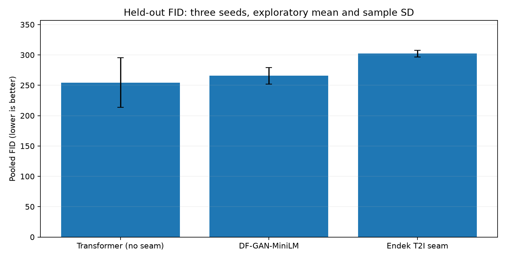

# Three-seed held-out evaluation: adapted DF-GAN and Endek T2I

Updated 20 November 2026. Three training seeds (42, 123, 2025), 37 independent test source images and 256 generated samples per run. Values are mean +/- sample standard deviation across seeds; not significance intervals.

| Model | Pooled FID (down) | Pooled KID (down) | Border gap (down) | LPIPS diversity (up) |
|---|---:|---:|---:|---:|
| Transformer no seam | 254.474 +/- 40.967 | 0.12848 +/- 0.05458 | 0.08993 +/- 0.01449 | 0.25630 +/- 0.21681 |
| DF-GAN-MiniLM adapted | 265.696 +/- 13.561 | 0.17703 +/- 0.00625 | 0.10984 +/- 0.01888 | 0.44268 +/- 0.03472 |
| Endek T2I seam | 302.127 +/- 5.459 | 0.19085 +/- 0.00405 | 0.05338 +/- 0.00120 | 0.03315 +/- 0.04134 |

Model identity: adapted DF-GAN uses frozen multilingual MiniLM384 rather than canonical DAMSM. It is not unmodified DF-GAN. The compared generators have different latent spaces.
Caution: FID/KID with 37 independent real samples are exploratory; improved edge continuity alone does not imply improved fidelity, diversity, prompt adherence or cultural authenticity. TiPGAN is train-only and not included in these held-out scores.

[Per-seed adapted DF-GAN](../results/DFGAN_V2_real_heldout_three_seeds.csv) | [All nine model-seed results](../results/DFGAN_EndekGAN_real_matched_three_seeds.csv) | [DF-GAN mean and SD](../results/DFGAN_V2_real_heldout_mean_sd.csv).

Supplementary numerical Figure S1. Exploratory held-out FID; not the manuscript Figure 1.
