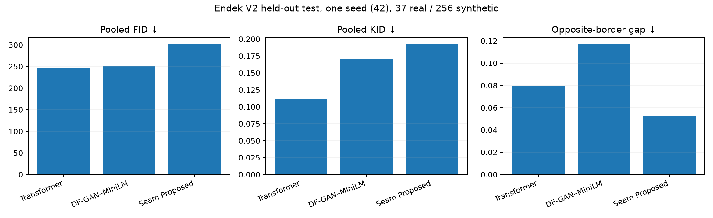

# Actual Kaggle V2 held-out comparison: DF-GAN–MiniLM, seed 42

Training best checkpoint chosen from validation KID 0.143294 at epoch 120; held-out testing uses 37 independent real images and 256 generated outputs. Results are sample-size-sensitive and exploratory.

| Method | Pooled FID ↓ | Pooled KID ↓ | Class-macro FID ↓ | Class-macro KID ↓ | Seam gap ↓ |
|---|---:|---:|---:|---:|---:|
| transformer | 247.819 | 0.111622 | 311.429 | 0.205214 | 0.079515 |
| DFGAN_MiniLM_adapted | 250.430 | 0.169826 | 310.283 | 0.199194 | 0.117372 |
| seam_proposed | 302.471 | 0.192888 | 360.429 | 0.365146 | 0.052456 |

Figure 15. Source-backed, one-seed held-out comparison. Do NOT claim model superiority on these limited sample counts.

This DF-GAN baseline is adapted to frozen multilingual MiniLM 384-dimensional embeddings, not the authors' original DAMSM conditioning.
TiPGAN is image-conditioned cloth texture synthesis, not text-to-image, and is therefore not assigned an invented text-prompt compliance score.
The two EndekGAN internal models have three completed seeds; adapted DF-GAN has one. Multi-seed DF-GAN replication and expert Endek evaluation remain pending.
Perceptual quality and semantic fidelity are not established by FID, KID or a simple seam gap.

Private Kaggle run: https://www.kaggle.com/code/agusperdana/endek-v2-dfgan-minilm-heldout-seed42-private
