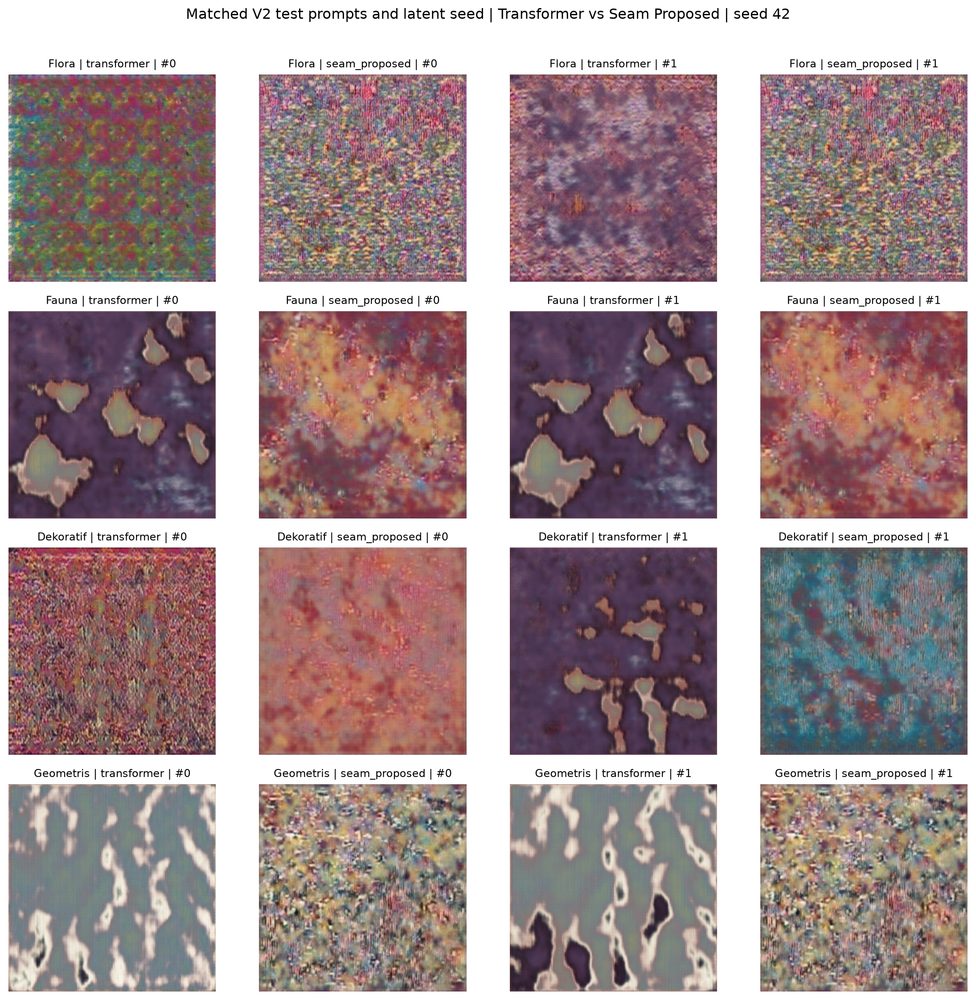
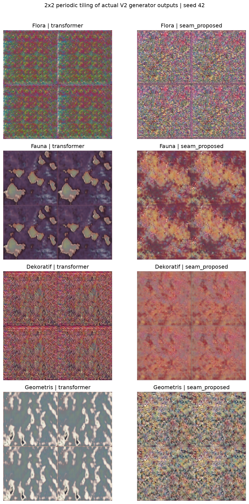
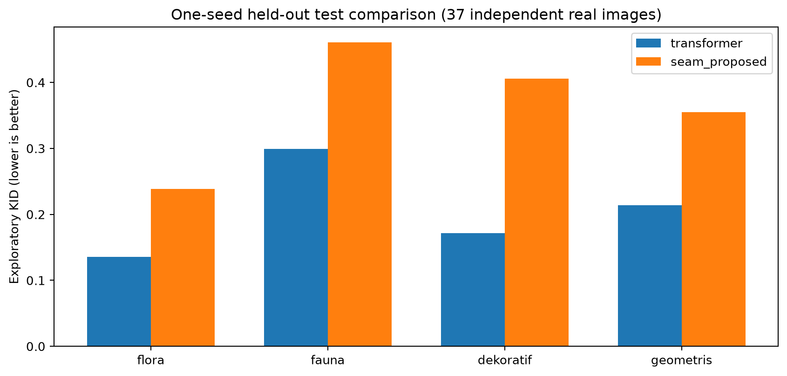

# Reference-anchored three-method benchmark: what is and is not complete

## Fixed research direction and literature
- **Main reference:** TiPGAN (He et al., *Computer-Aided Design*, 2025). Official code: https://github.com/VickyHEHonghong/TiPGAN. This is **image-conditioned tileable cloth texture synthesis**; it cannot be treated as a text-to-image architecture.
- **One additional external comparator:** DF-GAN (Tao et al., *CVPR*, 2022). Official code: https://github.com/tobran/DF-GAN. This is **text-to-image** using DAMSM text embeddings.
- **Proposed:** EndekGAN-T2I V2, frozen multilingual text conditioning plus seam-aware regularization, evaluated on a controlled source-aware data split. The old EndekGAN implementation already had seam and text features, so this is not claimed as a wholly new invented architecture.

## Verified Endek data and benchmark arms
- Original independent sources: **370** (train **296**, validation **37**, test **37**).
- Arm A: **944 derived training views**, originating from 296 train source images.
- Arm B: **1280 derived training views**, originating from 296 train source images, of which **336** are crops with inherited prompts **not semantically verified**.
- All 24 V2 model-seed training jobs are complete. Test-set evaluation is now complete for just **two Arm B seed-42** models: Transformer and Seam Proposed.

## Matched EndekGAN V2 test: two genuine trained models, one seed
Evaluation uses the same held-out prompt/source references, image resolution 256x256, 64 generated images per class, and generation RNG seed 90731. Prompt/source/index alignment was verified before making paired visualization panels.

| Metric (lower is better) | B Transformer seed 42 | B Seam Proposed seed 42 |
|---|---:|---:|
| Pooled FID (37 real / 256 generated) | 247.819 | 302.471 |
| Pooled KID | 0.111622 | 0.192888 |
| Class-macro FID | 311.429 | 360.429 |
| Class-macro KID | 0.205214 | 0.365146 |
| Unweighted class-macro opposite-border gap | 0.079515 | 0.052456 |

**Finding:** the seam penalty lowers *measured opposing-border gap* but the Transformer without seam is **better on FID/KID** under this one-seed exploratory test. These metrics do not directly measure expert-rated motif recognizability or text adherence. The test set contains only 37 independent images total, severely limiting FID/KID reliability.

### Actual GAN-generated-only comparison (no raw source images published)

**Figure 9.** Generated motif examples for Transformer versus Seam Proposed; for each row the models receive the exact same held-out prompt, class label, image index and latent RNG seed. Examples are fixed indices 0 and 1, not selected for best looks.

**Figure 10.** 2 x 2 periodic repetition of *actual* generated images at fixed example index 0 across four motif classes. Tiling measurements alone cannot validate motif semantics, culture or actual weaving feasibility.

**Figure 11.** Exploratory test KID per class, seed 42 only. Class-specific real reference count is only 5–15.

## External benchmark execution status and modality fairness

| Method | Original modality | Local V2 preparation | On-V2 training | Independent V2 scores |
|---|---|---|---|---|
| TiPGAN | Input image / patch texture | Official git cloned; 4 train-only class-balanced source exemplars selected privately | **NOT RUN** | **NOT AVAILABLE** |
| DF-GAN | Text via DAMSM encoder | Official git cloned; train-prompt pairs collected privately | **NOT RUN** | **NOT AVAILABLE** |
| EndekGAN V2 | Text + class / generated motif | 24 pretrained local V2 checkpoints verified | **COMPLETED** | **2 of 24 final tests** |

**TiPGAN comparability:** its normal research objective is to synthesize a tileable result from a supplied image. Use train-only texture exemplars and compare tileability, edge discontinuity and faithful texture preservation; do **not** score text-prompt adherence on a model that consumes no prompt. A per-texture trained TiPGAN is not a text-to-image baseline under the same input modality. Do not use held-out test images as TiPGAN's input texture while claiming independent test fidelity.

**DF-GAN comparability:** its official code uses a pretrained DAMSM encoder and claims at least 12 GB NVIDIA VRAM; local RTX 3070 Ti offers 8 GB. No Endek DAMSM weights were present in the official clone. Any replacement with MiniLM or reduced batch-size/architecture is **adapted DF-GAN** and must be named/disclosed as such. The earlier repo's DF-GAN results belong to a *different* data protocol and cannot be copied into the V2 three-way table.

## Verified blockers and next steps
1. TiPGAN's official checkout has \`train.py\` rather than README's mentioned \`train_tipgan.py\`; VGG weights required, not present. Its source checkout does not contain an explicit LICENSE file: verify rights before redistribution.
2. DF-GAN official training requires specific caption metadata, DAMSM checkpoints and a supported 12 GB+ GPU. Never silently replace with a non-equivalent model and call it a canonical reproduction.
3. For EndekGAN, finish matching **seeds 123 and 2025** before scientific multi-seed claims. Baseline models must use source-group-matched inputs, declared conditioning modalities and fixed output metrics.
4. Conduct counterfactual text prompts and blinded Endek expert review before claiming preservation of cultural patterns.

## Official-code environment blockers verified
- TiPGAN could not import in the current V2 Python environment because cv2 (OpenCV) is absent; VGG weights were also not present. No TiPGAN-Endek training has been performed.
- DF-GAN requires DAMSM text/image encoders and officially documents at least 12 GB NVIDIA VRAM; the local RTX 3070 Ti has 8 GB. Using a different text encoder or reduced model is an explicitly adapted benchmark, not exact replication.
- Only private, training-only reference-image/caption manifests have been prepared, with no dataset photographs published.

## Research status
**This is a verified two-way V2 test + external baseline input-preparation protocol, NOT a completed TiPGAN-vs-DF-GAN-vs-EndekGAN performance ranking.**

## New three-seed outcome

The internal matched B-arm comparison across seeds 42/123/2025 is **complete**. See [the verified six-test results with figures 12–14](THREE_SEED_TEST_REPORT.md). The original seed-42 table remains historical detail and is superseded by the three-seed summary for scientific discussion. External TiPGAN and DF-GAN still lack V2 results.
