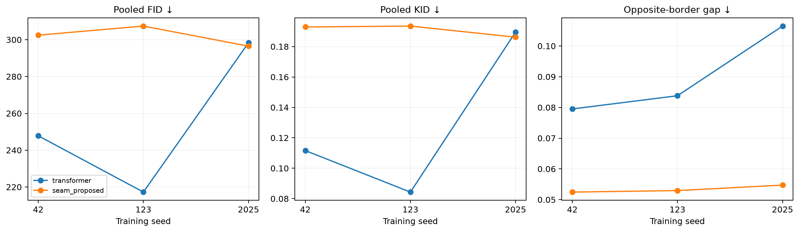
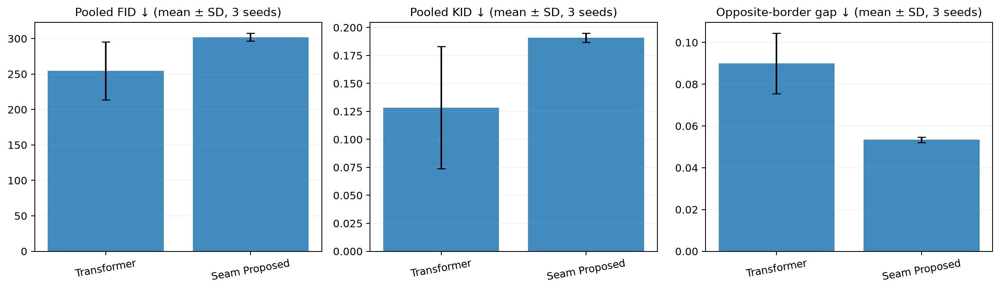
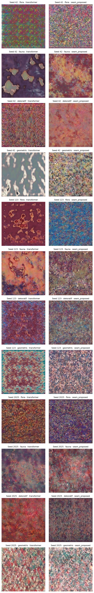

# EndekGAN V2 — Three-Seed Held-Out Test (Verified)

Methods: Transformer vs Seam Proposed, each seeds 42/123/2025, same grouped 296/37/37 split,
64 generated samples per class, 256 total per run, deterministic latent RNG seed 90731.
Test-based scores are reported **only after choosing best checkpoints from validation KID**.
**Caution:** FID/KID calculated with 37 real test sources (5–15 per class) are exploratory and sample-size biased.

## Table A. Three-seed held-out test mean ± sample SD

| Model | Pooled FID | Pooled KID | Class macro FID | Class macro KID | Seam gap |
|---|---:|---:|---:|---:|---:|
| transformer | 254.4740 ± 40.9668 | 0.1285 ± 0.0546 | 316.1448 ± 41.2703 | 0.2447 ± 0.0984 | 0.0899 ± 0.0145 |
| seam_proposed | 302.1274 ± 5.4585 | 0.1908 ± 0.0041 | 358.6532 ± 8.1246 | 0.3629 ± 0.0171 | 0.0534 ± 0.0012 |

## Table B. Per-seed values

| Model | Seed | Pooled FID | Pooled KID | Mean gap |
|---|---:|---:|---:|---:|
| transformer | 42 | 247.8185 | 0.111622 | 0.079515 |
| seam_proposed | 42 | 302.4706 | 0.192888 | 0.052456 |
| transformer | 123 | 217.2424 | 0.084323 | 0.083806 |
| seam_proposed | 123 | 307.4063 | 0.193473 | 0.052947 |
| transformer | 2025 | 298.3610 | 0.189510 | 0.106483 |
| seam_proposed | 2025 | 296.5054 | 0.186179 | 0.054733 |

## Figures

**Figure 12.** Matched-seed pooled test FID/KID and opposite-border gap for each seed. Smaller values are better; these axes measure different phenomena.

**Figure 13.** Mean ± sample SD over three training seeds, not a confidence interval and not a formal significance test.

**Figure 14.** Actual generated outputs at the first predetermined sample index for each class, model and seed; none cherry-picked.

## Reporting limitations
- Only two INTERNAL V2 architectures were compared; official TiPGAN and DF-GAN have not been retrained on the new Endek V2 data.
- TiPGAN is image-conditioned cloth texturing; its input modality cannot be treated as prompt-based.
- Small genuine image counts limit FID/KID reliability and do not establish cultural authenticity.
- The 1280 image files are source-derived views from 296 originals, not 1280 independent Endek motifs.
- No independent Endek expert evaluation or quantified semantic prompt adherence has yet been performed.
- These values represent the original training seed effects and finite sampled generated images, not definitive generalization evidence.
