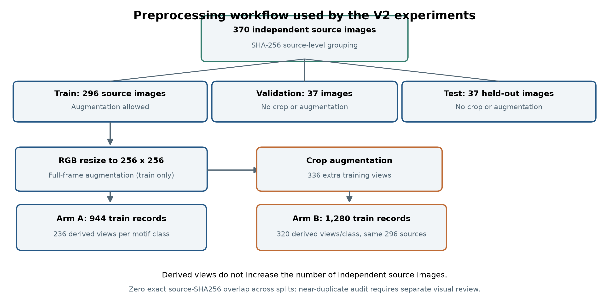
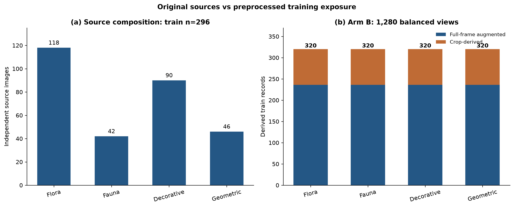
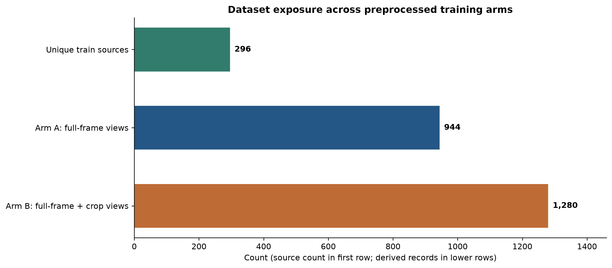
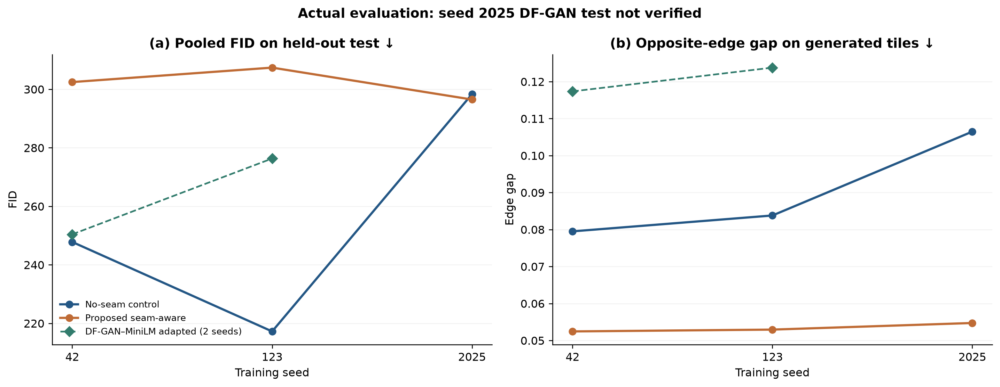
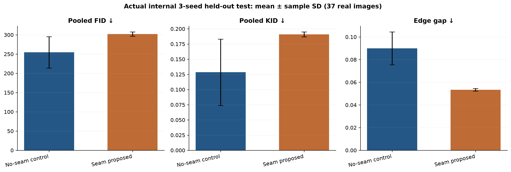
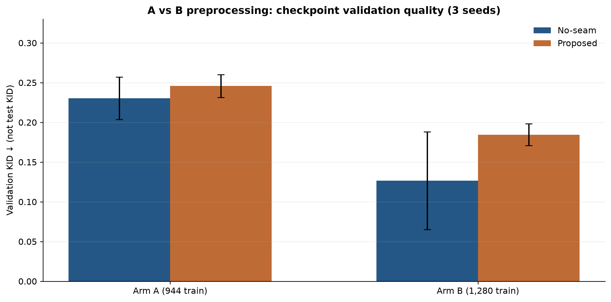

# IEEE Access Visual Evidence: Preprocessing and Evaluation

Working title: EndekGAN-T2I: Evaluating the Fidelity–Tileability Trade-off in Text-Conditioned Balinese Endek Motif Generation.

## Preprocessing figures and tables

**Figure 16:** Actual source-aware preprocessing: independent 296/37/37 partition; Arm A 944 and Arm B 1280 training views, including 336 extra train-only crops.

**Figure 17:** Independent image source counts and balanced derived training views across four classes. Never conflate the units.

**Figure 18:** Source count versus Arm A and Arm B derived training-file counts.

Preprocessing tables: [Table 1, class/arm/split distribution](../tables/TABLE_01_PREPROCESSED_CLASS_DISTRIBUTION.csv) and [Table 2, workflow stage counts](../tables/TABLE_02_PREPROCESSING_STAGE_COUNTS.csv).

## Evaluation figures and tables

**Figure 19:** Actual held-out pooled FID versus mean opposite-border gap; adapted DF-GAN has test results for seeds 42 and 123, not 2025.

**Figure 20:** Internal Transformer/no-seam control versus EndekGAN Seam Proposed; three independent training seeds, mean ± sample SD; 37 original held-out real references.

**Figure 21:** Arm A vs Arm B validation KID; do not mistake validation for held-out evaluation.

Evaluation tables: [Table 3, actual 3-seed internal test metrics](../tables/TABLE_03_MATCHED_HELDOUT_3SEED_MEAN_SD.csv) and [Table 4, external DF-GAN test status](../tables/TABLE_04_DFGAN_HELDOUT_STATUS.csv).

Additional source-derived training figures: [validation KID](../figures/fig02_all_24_validation_KID.png), [generator loss](../figures/fig04_generator_loss.png), [discriminator loss](../figures/fig05_discriminator_loss.png), [seam loss](../figures/fig06_seam_loss.png), and [three-seed generated examples](../figures/fig14_actual_B_generated_motifs_3seed_comparison.png).

## Confirmed post-preprocessing dataset

| Class | Arm B train | Validation | Held-out test | Independent train sources |
|---|---:|---:|---:|---:|
| Flora | 320 | 14 | 15 | 118 |
| Fauna | 320 | 6 | 5 | 42 |
| Decorative | 320 | 11 | 11 | 90 |
| Geometric | 320 | 6 | 6 | 46 |
| **Total** | **1,280** | **37** | **37** | **296** |

Arm A: 944 train records, same 296 independent train sources. Arm B: 944 full-frame/augmented records + 336 crop-derived records. Same validation/test split for both. Source SHA-256 overlap across splits: zero.
Prompt semantic and expert_verified flags remain false in the manifests. Additional source photographs from external datasets were NOT merged.

## Three-seed outcomes and limitations

| Model | Pooled FID mean ± SD ↓ | Pooled KID mean ± SD ↓ | Edge gap mean ± SD ↓ |
|---|---:|---:|---:|
| transformer | 254.47398 ± 40.96681 | 0.12848 ± 0.05458 | 0.08993 ± 0.01449 |
| seam_proposed | 302.12743 ± 5.45853 | 0.19085 ± 0.00405 | 0.05338 ± 0.00120 |

Seam Proposed reduces mean edge gap by approximately 40.65% but increases mean FID/KID and reduces LPIPS diversity. FID/KID with 37 real reference images are exploratory.
TiPGAN is IMAGE-conditioned tileable texture synthesis, not prompt-conditioned text-to-image: only a 30-iteration one-image compatibility pilot exists; no comparable converged test scores.
Adapted DF-GAN–MiniLM is not canonical DAMSM-conditioned DF-GAN; its third held-out seed is pending verification, so do not compute three-seed means.
Neither unverified prompt-image semantic alignment nor cultural authenticity of generated Endek is established by these metrics.

## Main references
1. He et al. (2025), TiPGAN, Computer-Aided Design 183, 103866, DOI: https://doi.org/10.1016/j.cad.2025.103866. Primary cloth-tileability, image-conditioned reference.
2. Tao et al. (2022), DF-GAN, CVPR, DOI: https://doi.org/10.1109/CVPR52688.2022.01602. Secondary text-to-image comparator.

Implementation and data-exposure caveat: multilingual text conditioning and seam regularization existed in the earlier EndekGAN-T2I study. V2 investigates source-aware preprocessing and a measured fidelity–tileability trade-off; it does not claim to invent these components.

## Reproduce locally
Execute the script scripts/build_ieee_access_visual_evidence.py from the authorized V2 project workspace; raw images, private paths, full manifests with prompts and checkpoint weights must remain private.
